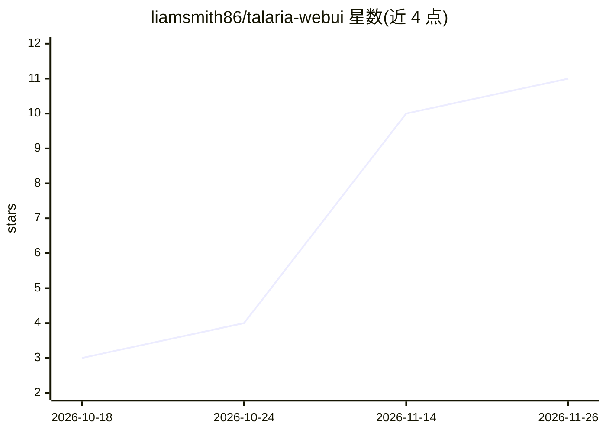

# liamsmith86/talaria-webui

⭐ 11 · Python · MIT · 推送 2026-11-25 · [GitHub](https://github.com/liamsmith86/talaria-webui) · [官网](https://fly.withtalaria.com/) · 个人维护

**自托管 Web 界面：远程连接并使用 Hermes Agent**

Talaria WebUI 是一个轻量的 Web 前端，通过 Hermes Agent 的 API server 功能远程连接用户的 agent，无需与 agent 安装在同一服务器；安装时需输入 API key 完成连接。可选安装 Hermes Agent 插件以扩展 API 返回的信息。提供流式回复、Markdown/代码渲染、会话管理（搜索/置顶/分支/编辑）、多配置切换、7 种界面语言与明暗主题。安装方式包括脚本、Docker 镜像和源码构建，MIT 许可。

## 筛选速览

| 维度 | 判定 | 备注 |
|---|---|---|
| AI 角色 | `ai-ecosystem` | LLM/agent 周边工具 |
| 许可风险 | `permissive` | MIT |
| 部署形态 | `self-host` | docker 或自建部署 |
| 模型依赖 | — | README 未给出锁定关系 |
| 硬件要求 | — | 无带数字的原话,不猜 |
| 安装摩擦 | `low` | 无编译、无系统依赖或容器化 |
| 成熟度 | — | 结构信号不足 |

## 能力要点

- 通过 Hermes Agent API server 远程连接，不要求同机部署
- 流式回复展示推理与工具活动，支持中途停止或追加指引
- 会话搜索、置顶、分支、编辑与转录下载等管理功能
- 可选 Hermes 插件扩展 UI 可展示的信息

## 适用场景

- 自托管场景下为 Hermes Agent 提供浏览器聊天界面
- 在移动设备上通过 home screen 访问 agent 会话
- 管理多个 Hermes 配置并在其间切换

## 场景标签

`聊天机器人` · 领域:对话与助手

## 证据(README 行号)

> L16: Talaria WebUI is a lightweight, performant, and secure application for chatting with your Hermes Agent. The core de
> L18: Talaria WebUI uses Hermes Agent's API server feature to interface with your agent and upon installation you will be

## 星数曲线

2026-10-18 3 → 2026-11-26 11（+8）

---
*卡片 v1 · prompt 1.4 · 生成 2026-11-19 · 置信度 high · 依据 README sha `1d0136b982ea` · [字段定义](../../DATASET.md)*
