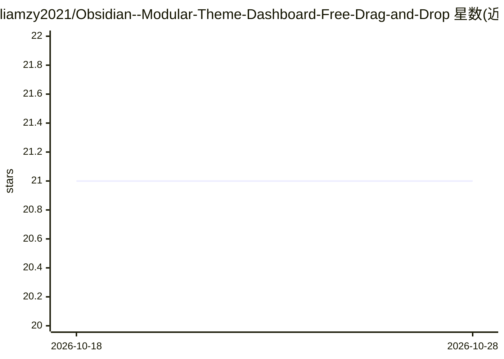

# liamzy2021/Obsidian--Modular-Theme-Dashboard-Free-Drag-and-Drop

⭐ 21 · CSS · MIT · 推送 2026-07-14 · [GitHub](https://github.com/liamzy2021/Obsidian--Modular-Theme-Dashboard-Free-Drag-and-Drop) · 个人维护 · 中文 README

**Obsidian 模块化仪表盘插件：拖拽主页+多格式查看器+AI翻译/转录**

Obsidian 仪表盘插件，提供自由拖拽的绝对定位画布、25 个内置模块（天气、待办、日历、AI Insight 等）、10+ 格式文件查看器（xlsx/docx/pptx/mp4 等闪电表格查看器含小数精度与多工作表切换）、笔记内图片/媒体画廊代码块与 8 套主题。AI 功能为组成部分：通过 OpenAI 兼容 API 将 500+ UI 字符串翻译成任意语言（含方言）、音频视频右键转录（云端或本地 faster-whisper-server/LocalAI/docker-whisper），去掉 AI 仪表盘本身仍可用。安装经 GitHub 手动放入插件目录或社区插件市场。

## 筛选速览

| 维度 | 判定 | 备注 |
|---|---|---|
| AI 角色 | `ai-enhanced` | 去掉 AI 部分产品仍成立 |
| 许可风险 | `permissive` | MIT |
| 部署形态 | `None` |  |
| 模型依赖 | — | README 未给出锁定关系 |
| 硬件要求 | — | 无带数字的原话,不猜 |
| 安装摩擦 | `low` | 无编译、无系统依赖或容器化 |
| 成熟度 | — | 结构信号不足 |

## 能力要点

- 25 个内置模块与无限实例克隆（module#N 独立配置）
- 闪电表格查看器：任意大小表格即时打开、0-10 位小数精度、多工作表切换
- AI 自定义语言：OpenAI 兼容 API 翻译 500+ UI 字符串，支持方言
- 音频/视频右键转录：云端（SiliconFlow/Groq 等）或本地 faster-whisper-server/LocalAI

## 适用场景

- 在 Obsidian 内搭建可拖拽的个人主页仪表盘
- 不离开 Obsidian 直接查看表格/Word/PPT/媒体文件
- 用 AI 把插件界面翻译成方言或小语种
- 右键把录音或视频转写为笔记文本

## 场景标签

`语音识别` · 领域:感知与多模态

## 证据(README 行号)

> L32: **How it works:** Enter your OpenAI-compatible API key, type the target language (e.g., `日本語`, `Русский`, `四川话`, `K
> L136: |🖥️ **Local AI**|faster-whisper-server, LocalAI, docker-whisper — any OpenAI-compatible /v1/audio/transcriptions s

## 星数曲线

2026-10-18 21 → 2026-10-28 21（+0）

---
*卡片 v1 · prompt 1.4 · 生成 2026-10-28 · 置信度 high · 依据 README sha `354f30448954` · [字段定义](../../DATASET.md)*
