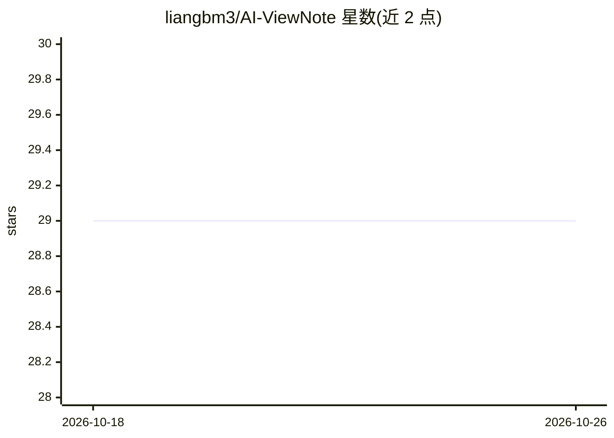

# liangbm3/AI-ViewNote

⭐ 29 · TypeScript · MIT · 推送 2026-04-01 · [GitHub](https://github.com/liangbm3/AI-ViewNote) · 个人维护 · 中文 README

**AI 音视频笔记桌面应用：把音视频转成结构化文字笔记**

基于 Wails v3 + React/TypeScript 的桌面应用，面向需要将视频/音频内容转为笔记的用户。流程为：本地 FFmpeg 处理音视频并提取音频，云端 ASR（火山引擎）转写为文本，再通过 OpenAI 兼容接口调用 LLM 生成知识笔记、小红书风格、公众号风格、内容总结等多种笔记，支持基于生成内容继续 AI 对话、自定义提示词、Markdown 与字幕导出。使用前需自行配置 LLM、ASR 与对象存储（TOS）的 API 密钥。

## 筛选速览

| 维度 | 判定 | 备注 |
|---|---|---|
| AI 角色 | `ai-native` | 本体是模型或模型工具 |
| 许可风险 | `permissive` | MIT |
| 部署形态 | `None` |  |
| 模型依赖 | — | README 未给出锁定关系 |
| 硬件要求 | — | 无带数字的原话,不猜 |
| 安装摩擦 | `medium` | 含编译或系统依赖之一 |
| 成熟度 | — | 结构信号不足 |

## 能力要点

- 本地 FFmpeg 音视频处理与音频提取
- 云端 ASR 转写 + OpenAI 兼容接口生成 4 种风格笔记
- AI 对话追问、自定义提示词、Markdown/字幕导出
- 基于 Wails v3 的桌面应用，React + TypeScript 前端

## 适用场景

- 把网课、讲座视频转成带时间标记的知识笔记
- 将视频内容改写为小红书/公众号风格文章
- 对转写文本继续提问和二次整理

## 场景标签

`语音识别` `AI 写作` · 领域:内容生成

## 证据(README 行号)

> L7:  🤖 AI-powered video note-taking application that transforms audio and video content into structured text notes.
> L14: AI-ViewNote 是一款基于 Wails v3 构建的现代化桌面应用程序，集成了本地音视频处理、云端语音识别（ASR）以及大语言模型（LLM）能力，帮助用户将视频或音频内容智能转化为结构化的文字笔记。🎯 支持多种笔记风格，满

## 星数曲线

2026-10-18 29 → 2026-10-26 29（+0）

---
*卡片 v1 · prompt 1.4 · 生成 2026-10-26 · 置信度 high · 依据 README sha `20a52237c505` · [字段定义](../../DATASET.md)*
