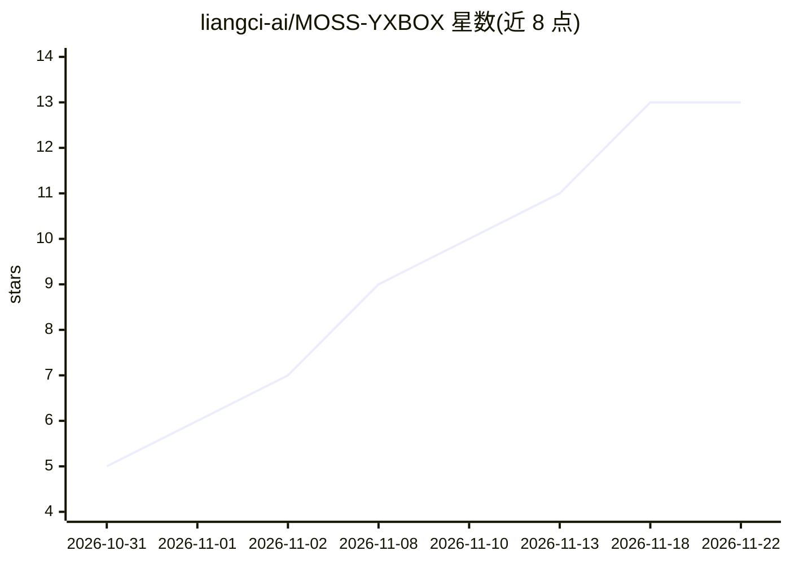

# liangci-ai/MOSS-YXBOX

⭐ 13 · JavaScript · MIT · 推送 2026-11-19 · [GitHub](https://github.com/liangci-ai/MOSS-YXBOX) · 个人维护 · 中文 README

**给 ComfyUI 用户的中文画布排版节点：统一生成布局框与提示词**

一个 ComfyUI 自定义节点，把官方 Create Bounding Boxes 与 MOSS-Image Layout Prompt 合并为单个中文节点。提供可拖拽画布：物体/文字/角色框同画布编辑、16 像素点阵吸附、逐行参数列表、最多 64 张背景图分层压暗。输出前置提示词+布局 JSON+后置提示词，与官方节点格式逐字节一致；支持从 PNG 内嵌工作流反读布局、导入导出布局提示词并自动修复常见 JSON 错误。安装需放入 custom_nodes 目录并要求 ComfyUI 自带 MOSS-Image 节点。

## 筛选速览

| 维度 | 判定 | 备注 |
|---|---|---|
| AI 角色 | `ai-ecosystem` | LLM/agent 周边工具 |
| 许可风险 | `permissive` | MIT |
| 部署形态 | `None` |  |
| 模型依赖 | — | README 未给出锁定关系 |
| 硬件要求 | — | 无带数字的原话,不猜 |
| 安装摩擦 | `low` | 无编译、无系统依赖或容器化 |
| 成熟度 | — | 结构信号不足 |

## 能力要点

- 合并官方两个节点为单节点，输出 JSON 与官方逐字节一致
- 可拖拽画布：16 像素点阵吸附、缩放平移、逐框参数锁与多选
- 导入 PNG 自动读取内嵌工作流中的布局 JSON 并还原画布
- 容忍带伤 JSON 导入：自动修复换行/全角引号/多余逗号并文本兜底

## 适用场景

- 在 ComfyUI 里用框规划文生图的多物体布局
- 从已有生成图反推当时的排版布局再微调
- 把 LLM 输出的布局 JSON 直接粘贴还原为画布

## 场景标签

`图像生成` · 领域:内容生成

## 证据(README 行号)

> L13: 把 ComfyUI 官方的 **「Create Bounding Boxes」** 与 **「MOSS-Image Layout Prompt」** 合成 **一个** 中文节点，配一块能直接拖的布局画布：
> L26: **MOSS YXBOX** merges ComfyUI's official **Create Bounding Boxes** and **MOSS-Image Layout Prompt** nodes into a si

## 星数曲线

2026-10-31 5 → 2026-11-22 13（+8）

---
*卡片 v1 · prompt 1.4 · 生成 2026-11-18 · 置信度 high · 依据 README sha `dcff2e61b4fa` · [字段定义](../../DATASET.md)*
