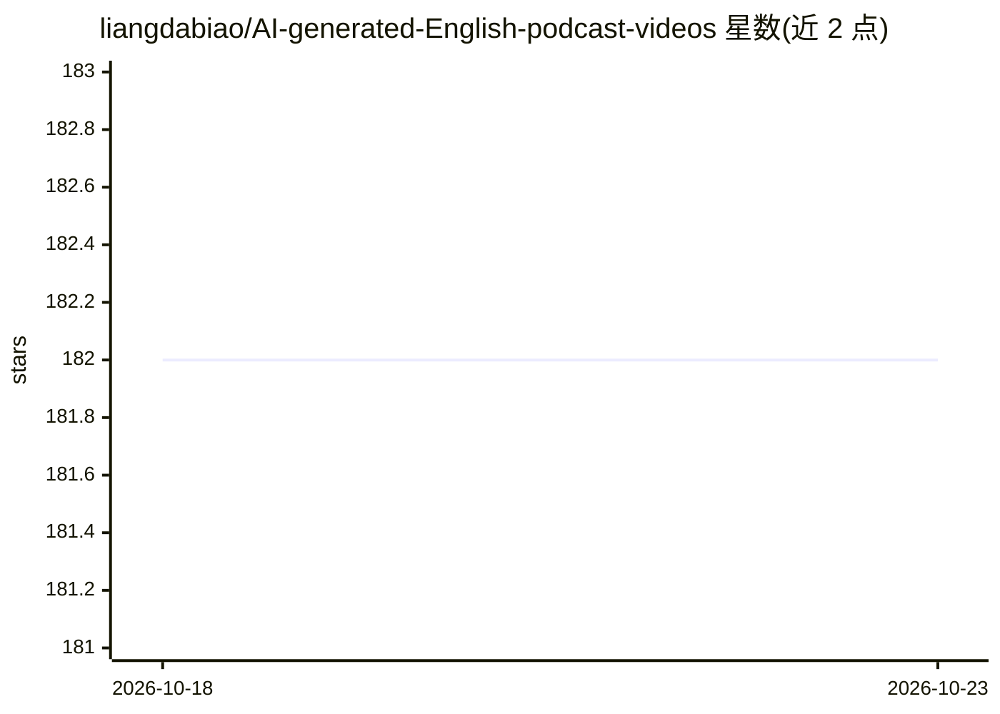

# liangdabiao/AI-generated-English-podcast-videos

⭐ 182 · Python · MIT · 推送 2026-06-25 · [GitHub](https://github.com/liangdabiao/AI-generated-English-podcast-videos) · [官网](https://skillhub.cn/skills/user_8bb4b4f5/story-handdrawn-remotion) · 个人维护 · 中文 README

**把文章一键生成英语双人播客教学短视频的工具**

面向英语学习/短视频创作者的自托管工具：粘贴文章文本，经 MiniMax LLM 生成播客脚本与素材关键词，apimart 逐句生成图片，MiniMax TTS 合成双说话人语音，最后由 ffmpeg 拼接并混入背景音乐，输出竖屏无字幕视频。提供 Streamlit WebUI 与 HTTP API，支持 Docker Compose 部署。运行需 MiniMax 与 apimart 的 API key，Python 3.11 与 FFmpeg，纯 CPU 运行无需 GPU。

## 筛选速览

| 维度 | 判定 | 备注 |
|---|---|---|
| AI 角色 | `ai-native` | 本体是模型或模型工具 |
| 许可风险 | `permissive` | MIT |
| 部署形态 | `self-host` | docker 或自建部署 |
| 模型依赖 | — | README 未给出锁定关系 |
| 硬件要求 | — | 无带数字的原话,不猜 |
| 安装摩擦 | `low` | 无编译、无系统依赖或容器化 |
| 成熟度 | — | 结构信号不足 |

## 能力要点

- MiniMax LLM/TTS + apimart 生图的三段式生成管线
- Streamlit WebUI 与 HTTP API 双入口
- 双说话人英文音色选择与试听，内置 29 首背景音乐
- 纯 CPU 运行，无需 CUDA/GPU/torch

## 适用场景

- 把英语学习文章转成播客式短视频自学
- 批量生成英语教学内容发布到短视频平台
- 通过 HTTP API 集成到自己的内容生产流程

## 场景标签

`语音合成` `视频生成` · 领域:内容生成

## 证据(README 行号)

> L11: |**LLM**（脚本与关键词）|MiniMax|`MiniMax-M2.5`（`/v1/text/chatcompletion_v2`）|
> L12: |**TTS**（语音合成）|MiniMax|`speech-2.6-hd`（`/v1/t2a_v2`）|
> L13: |**生图**（素材）|apimart|`gemini-3.1-flash-image-preview`（`/v1/images/generations`）|
> L16: 文章 → MiniMax LLM（播客脚本）→ MiniMax LLM（关键词）

## 星数曲线

2026-10-18 182 → 2026-10-23 182（+0）

---
*卡片 v1 · prompt 1.4 · 生成 2026-10-22 · 置信度 high · 依据 README sha `7ff7e7cde266` · [字段定义](../../DATASET.md)*
