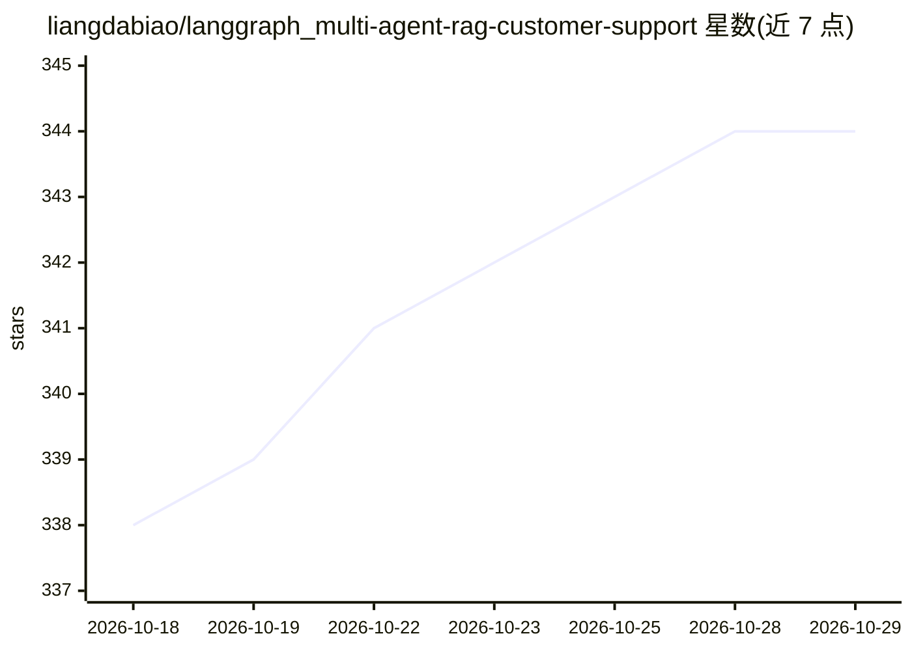

# liangdabiao/langgraph_multi-agent-rag-customer-support

⭐ 344 · Python · 推送 2026-07-10 · [GitHub](https://github.com/liangdabiao/langgraph_multi-agent-rag-customer-support) · [官网](https://skillhub.cn/skills/user_8bb4b4f5/deep-research-agent-skill) · 个人维护 · 中文 README

**多智能体 RAG 客服系统：处理旅行与商城查询并带安全审核**

基于 Python、LangChain 和 LangGraph 构建的多智能体 RAG 客户支持系统，fork 自 ro-anderson 的基础框架并扩展。主助手按需将对话路由到航班、租车、酒店、行程、WooCommerce、表单、博客等专门助手；使用 Qdrant 向量数据库与 SQLite 旅行数据库做检索。新增安全护栏（越狱防护与相关性检查）和 GoHumanLoop 人工审核流程（如飞书通知），敏感操作需用户确认加管理员批准双重把关。提供命令行与 Web 界面两种运行方式。

## 筛选速览

| 维度 | 判定 | 备注 |
|---|---|---|
| AI 角色 | `ai-native` | 本体是模型或模型工具 |
| 许可风险 | `none` | — |
| 部署形态 | `self-host` | docker 或自建部署 |
| 模型依赖 | — | README 未给出锁定关系 |
| 硬件要求 | — | 无带数字的原话,不猜 |
| 安装摩擦 | `low` | 无编译、无系统依赖或容器化 |
| 成熟度 | — | 结构信号不足 |

## 能力要点

- LangGraph 状态图实现多智能体路由（航班/租车/酒店/行程/商城等助手）
- 安全护栏：越狱防护与业务相关性检查，拦截无关或攻击性输入
- GoHumanLoop 人工审核：敏感操作经用户确认后还需管理员批准（支持飞书通知）
- 集成 LangSmith 可观测性与 Qdrant 向量数据库，支持 WooCommerce 商城功能

## 适用场景

- 搭建可处理跨领域复杂查询的旅行与电商 AI 客服
- 参考安全护栏+人工审核模板加固自己的 AI 应用
- 学习 LangGraph 多智能体协作与 RAG、工具调用的综合实践

## 场景标签

`多智能体` `RAG` · 领域:Agent 开发

## 证据(README 行号)

> L5: 本项目实现了一个基于多智能体（Multi-Agent）和检索增强生成（Retrieval-Augmented Generation, RAG）技术的客户支持系统。它利用 Python、LangChain 和 LangGraph 构建
> L21: 1. **主助手 (Primary Assistant)**: 用户查询的入口点。它根据用户需求将对话路由到专门的助手。
> L37:  * **人工审核 (GoHumanLoop)**: 敏感操作在用户确认后，还需通过 GoHumanLoop 框架发送给管理员进行最终审核（例如通过飞书通知）。

## 星数曲线

2026-10-18 338 → 2026-10-29 344（+6）

---
*卡片 v1 · prompt 1.4 · 生成 2026-10-21 · 置信度 mid · 依据 README sha `2bdda045911c` · [字段定义](../../DATASET.md)*
