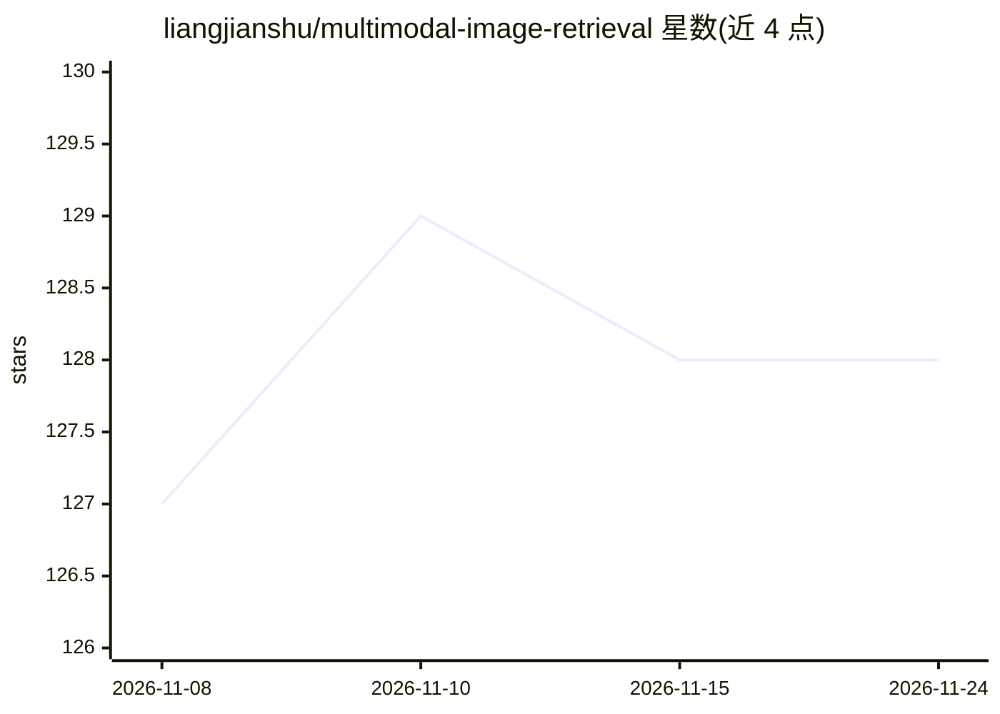

# liangjianshu/multimodal-image-retrieval

⭐ 128 · Python · MIT · 推送 2026-11-05 · [GitHub](https://github.com/liangjianshu/multimodal-image-retrieval) · [官网](https://liangjianshu.github.io/multimodal-image-retrieval/overview/) · 个人维护 · 中文 README

**多模态图像检索实战项目：文搜图/图搜图与微调训练指南**

面向学习多模态检索与模型微调的开源实践项目：以 Qwen 做意图识别与路由，提供两条检索路线——路线 A 用 Qwen 生成类别与描述做语义索引（支持 LoRA/SFT 微调），路线 B 用 EmbeddingGemma 2 直接编码原图并做多正样本 InfoNCE 对比学习训练。含 2,000 张图库的 F1/mAP 评测、消融实验、自有数据接入（JSONL 清单）与命令行检索原型。限制：作者微调权重未分发，无在线推理服务与向量数据库。

## 筛选速览

| 维度 | 判定 | 备注 |
|---|---|---|
| AI 角色 | `ai-native` | 本体是模型或模型工具 |
| 许可风险 | `permissive` | MIT |
| 部署形态 | `library` | 以包/库形式分发 |
| 模型依赖 | — | README 未给出锁定关系 |
| 硬件要求 | — | 无带数字的原话,不猜 |
| 安装摩擦 | `low` | 无编译、无系统依赖或容器化 |
| 成熟度 | — | 结构信号不足 |

## 能力要点

- Qwen 意图识别统一入口，区分检索与普通问答
- 路线 A：Qwen LoRA/SFT 类别语义索引；路线 B：EmbeddingGemma 2 原图编码 + 多正样本 InfoNCE
- 8 组配置、24 个验证检查点的固定图库评测与消融报告
- JSONL 图片清单接入自有数据，12 张示例图零模型依赖回放演示

## 适用场景

- 电商图搜商品与相似款发现，文字搜自有商品图库
- 设计素材库、企业私有图片资料库的自然语言检索
- 学习 Qwen 微调、对比学习与 RAG 检索组件开发

## 场景标签

`多模态` `微调` `语义搜索` · 领域:知识与检索

## 证据(README 行号)

> L8: **给一张图，找相似商品；写一句话，搜自己的图片库。** 从意图识别、Prompt 工程与 Qwen LoRA 微调，到 EmbeddingGemma 2 原图编码、多正样本 InfoNCE 对比学习，再到可复核的训练与评测。
> L40: |**多模态检索**|支持文字、参考图及图文组合查询，对比语义描述与原图向量两条路线。|
> L45: |**对比学习 / 多正样本 InfoNCE**|文图／图图训练、困难负例、同类批内多正例；全参数微调与验证选参。|

## 星数曲线

2026-11-08 127 → 2026-11-24 128（+1）

---
*卡片 v1 · prompt 1.4 · 生成 2026-11-17 · 置信度 high · 依据 README sha `d98d8f7d3aee` · [字段定义](../../DATASET.md)*
