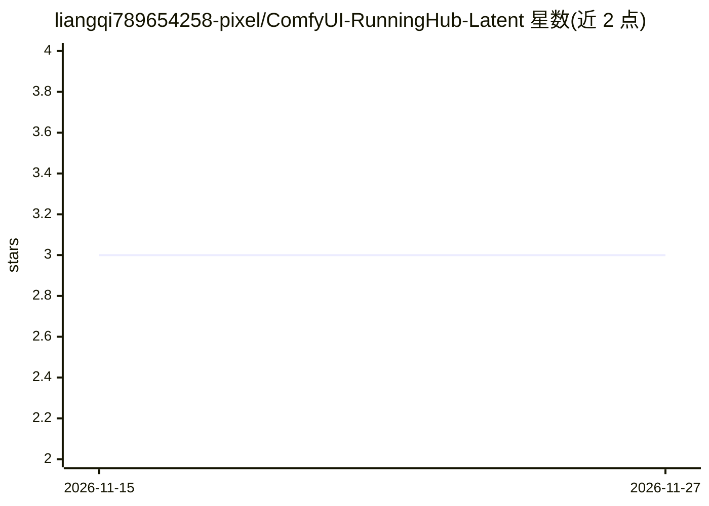

# liangqi789654258-pixel/ComfyUI-RunningHub-Latent

⭐ 3 · Python · NOASSERTION · 推送 2026-10-24 · [GitHub](https://github.com/liangqi789654258-pixel/ComfyUI-RunningHub-Latent) · 个人维护 · 中文 README

**把 RunningHub 云端当远程采样器的 ComfyUI 插件，本地完成 VAE 解码**

ComfyUI 插件与配套桌面程序：将采样任务提交到 RunningHub 云端工作流，云端只回传 latent 二进制，VAE 解码在本地执行，输出原生 LATENT、PNG 或 mp4。提供 6 个节点（极简/专业采样、taskId 续取、URL 加载、参数探查、缓存管理），支持提示词占位符自动注入、node_overrides 参数映射、本地 latent 缓存零成本重放。需 RunningHub 账号与 API Key，云端工作流末端必须接「保存Latent」节点；显存压力集中在本地解码，低显存需用 VAEDecodeTiled。

## 筛选速览

| 维度 | 判定 | 备注 |
|---|---|---|
| AI 角色 | `ai-native` | 本体是模型或模型工具 |
| 许可风险 | `none` | NOASSERTION |
| 部署形态 | `library` | 以包/库形式分发 |
| 模型依赖 | — | README 未给出锁定关系 |
| 硬件要求 | — | 无带数字的原话,不猜 |
| 安装摩擦 | `medium` | 含编译或系统依赖之一 |
| 成熟度 | — | 结构信号不足 |

## 能力要点

- 云端采样只回传 latent，本地任意 VAE 解码，输出原生 LATENT / PNG / mp4
- 占位符 {positive}/{negative} 自动注入与 node_overrides 参数映射，冲突或缺失时明确报错
- 本地 latent 缓存：重复参数零成本重放，不扣云端积分
- 独立 PySide6 桌面出图器，含任务台账、每日积分上限护栏与按 taskId 续取

## 适用场景

- 本地显卡跑不动大模型时只把采样卸到云端
- 想用本地 VAE 替换云端固定 VAE 调画质
- 本地不存放十几 GB checkpoint 只装一个 VAE 出图
- 视频采样后低显存本地分块解码出片

## 场景标签

`图像生成` `视频生成` · 领域:内容生成

## 证据(README 行号)

> L6: 把 **RunningHub 云端当作远程采样器** 用：云端跑完采样后只回传 latent，
> L67: |根目录|ComfyUI 插件：在画布上拖节点出图|已经在用 ComfyUI 的人|
> L305: 3. **解码输出是帧序列 IMAGE**，接 VHS 的 `VHS_VideoCombine` 成片即可

## 星数曲线

2026-11-15 3 → 2026-11-27 3（+0）

---
*卡片 v1 · prompt 1.4 · 生成 2026-11-26 · 置信度 high · 依据 README sha `475813109190` · [字段定义](../../DATASET.md)*
