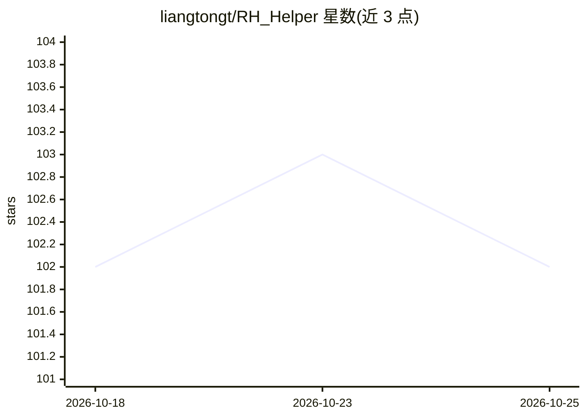

# liangtongt/RH_Helper

⭐ 102 · 推送 2026-10-25 · [GitHub](https://github.com/liangtongt/RH_Helper) · 个人维护 · 中文 README

**给 RunningHub 用户的 latent 解码与去水印辅助工具**

集成 ComfyUI 环境的一键运行工具：解压后双击 run.bat 即可使用，提供图片/视频 latent 解码（可选 VAE 模型，默认 vae-ft-mse-840000-ema-pruned）、图片快速/质量去水印、去马赛克与模型下载管理。面向 RunningHub 工作流用户，绕过平台输出限制；亦提供自有 ComfyUI 环境用户的直接工作流方案。当前主版本为 CPU 运行，解码速度受 CPU 性能限制，另发布 CUDA 版本（2G 显存可解码）。仅支持 Windows，含移动端浏览器访问界面。

## 筛选速览

| 维度 | 判定 | 备注 |
|---|---|---|
| AI 角色 | `ai-native` | 本体是模型或模型工具 |
| 许可风险 | `none` | — |
| 部署形态 | `desktop` | 安装包/桌面程序 |
| 模型依赖 | — | README 未给出锁定关系 |
| 硬件要求 | `gpu-8g` | |
| 安装摩擦 | `low` | 无编译、无系统依赖或容器化 |
| 成熟度 | — | 结构信号不足 |

## 能力要点

- 图片/视频 latent 解码，支持自行加载其他 VAE 模型
- 快速/质量去水印与去马赛克功能
- 集成全部环境依赖与模型，双击运行，无需配置
- 另有 CUDA 版本，2G 显存即可解码

## 适用场景

- 我在 RunningHub 上跑的工作流想拿到完整解码结果
- 需要解码本地 latent 文件为图片或视频
- 给生成的图片快速去水印

## 场景标签

`图像视频处理` · 领域:感知与多模态

## 证据(README 行号)

> L40: - 图片latent解码
> L53: 在对比了常见VAE模型后，选择了vae-ft-mse-840000-ema-pruned.safetensors 作为默认模型，解码速度较快，占用内存少。需要兼容其他模型可自行下载放于comfyui/models/vae文件夹下。

## 星数曲线

2026-10-18 102 → 2026-10-25 102（+0）

---
*卡片 v1 · prompt 1.4 · 生成 2026-10-18 · 置信度 high · 依据 README sha `73d0642afc58` · [字段定义](../../DATASET.md)*
