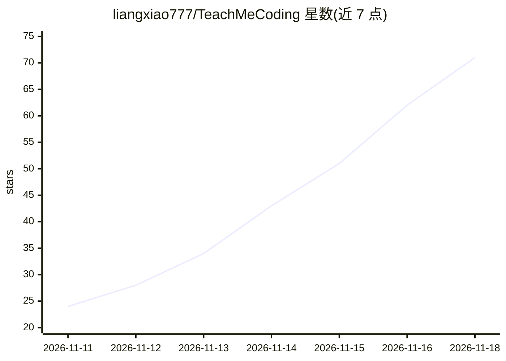

# liangxiao777/TeachMeCoding

⭐ 71 · TypeScript · Apache-2.0 · 推送 2026-10-30 · [GitHub](https://github.com/liangxiao777/TeachMeCoding) · 个人维护 · 中文 README

**本地运行的 AI 编程老师：生成学习路线、课件与执行测评**

单进程 Node 应用，教学 agent 澄清学习需求后规划路线图、编写课件，用户在内置 IDE 与真实终端中练习；代码提交先在本机运行，输出被核验后再由模型评估，支持 Python/JavaScript/TypeScript/Rust/Bash。路线调整、课件重写、文件编辑等以提案形式需确认，可按会话开启 YOLO 自动接受。通过 Pi 接入多家模型提供商，数据存本地 SQLite，仅支持 macOS 与 Linux，处于 alpha 早期阶段；agent 可读写文件、执行 Bash 与联网，非沙箱环境。

## 筛选速览

| 维度 | 判定 | 备注 |
|---|---|---|
| AI 角色 | `ai-native` | 本体是模型或模型工具 |
| 许可风险 | `permissive` | Apache-2.0 |
| 部署形态 | `library` | 以包/库形式分发 |
| 模型依赖 | — | README 未给出锁定关系 |
| 硬件要求 | — | 无带数字的原话,不猜 |
| 安装摩擦 | `medium` | 含编译或系统依赖之一 |
| 成熟度 | `idea` | |

## 能力要点

- 生成阶段化学习路线图与课件，单元按解锁顺序推进
- 代码提交本机运行后以执行结果支撑评估，支持 5 种语言
- 路线/课件/文件修改以提案确认，或按会话开启 YOLO 自动接受
- 通过 Pi 接入多家模型提供商，支持 MCP 服务与 Skills 安装

## 适用场景

- 让 AI 为我定制 Rust 或前端等编程学习路线并陪练
- 在本地 IDE 和真实终端中练习并接受基于运行结果的测评
- 上传参考资料让 agent 按需阅读作为学习材料

## 场景标签

 · 领域:教育/编程学习

## 证据(README 行号)

> L7:  An AI coding tutor that runs locally: turn learning goals into a roadmap and lessons, practice in real projects, an
> L22: TeachMeCoding creates a separate learning space for each learning goal. The teaching agent clarifies your needs, pl
> L34: - **Assessments backed by execution evidence**: coding submissions run locally and their output is checked, with su

## 星数曲线

2026-11-11 24 → 2026-11-18 71（+47）

---
*卡片 v1 · prompt 1.4 · 生成 2026-11-18 · 置信度 high · 依据 README sha `065eafb2b423` · [字段定义](../../DATASET.md)*
