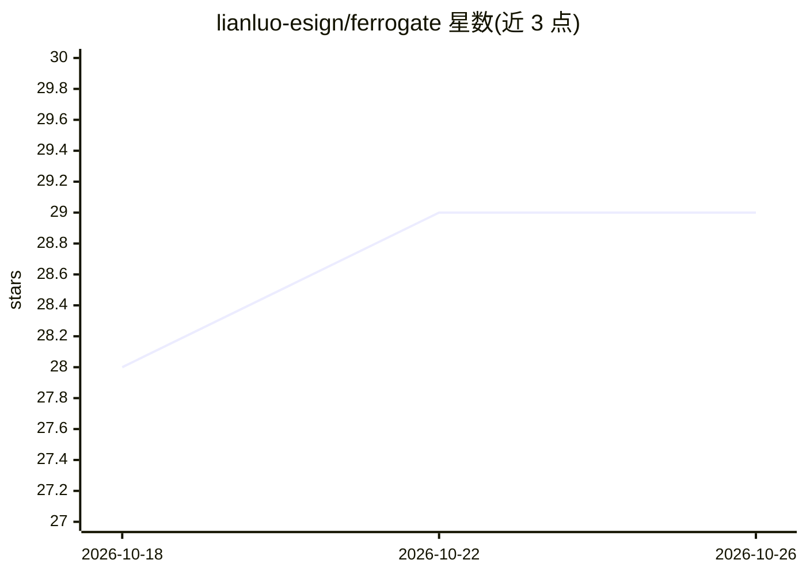

# lianluo-esign/ferrogate

⭐ 29 · TypeScript · NOASSERTION · 推送 2026-09-25 · [GitHub](https://github.com/lianluo-esign/ferrogate) · [官网](https://token4ai.cloud) · 组织维护 · 中文 README

**运行在 Cloudflare Workers 上的开源 AI 网关，做多供应商路由与租户管控**

用 TypeScript 编写的 AI 流量网关，部署为基于 D1/R2/KV/Durable Objects/Queues/Analytics Engine 的 Workers 集群。提供 OpenAI 兼容与 Anthropic 原生推理 API、Files + Batch 接口、多供应商路由（灰度/影子发布、熔断与故障转移）、带作用域的虚拟 API key、按租户隔离的 SQLite Durable Object 存储、限流/配额/预付钱包/计费账本、护栏筛查、响应缓存、MCP 服务器与 agent 运行时，以及约 240 个操作的管理 API。六个部署单元：网关、控制面、MCP、agent-runtime、telemetry 五个 Worker 加一个 CLI。面向自托管与构建 LLM 网关服务的开发者/运维方，是 Token4AI Cloud 的开源网关基础。限制：依赖 Bun 与 Wrangler，Durable Objects/Queues/Analytics Engine 需 Cloudflare 付费计划；三个函数/工具执行操作被明确拒绝（501 capability_not_offered）。

## 筛选速览

| 维度 | 判定 | 备注 |
|---|---|---|
| AI 角色 | `ai-ecosystem` | LLM/agent 周边工具 |
| 许可风险 | `none` | NOASSERTION |
| 部署形态 | `None` |  |
| 模型依赖 | — | README 未给出锁定关系 |
| 硬件要求 | — | 无带数字的原话,不猜 |
| 安装摩擦 | `low` | 无编译、无系统依赖或容器化 |
| 成熟度 | — | 结构信号不足 |

## 能力要点

- OpenAI 兼容 + Anthropic 原生推理 API，SSE 流式逐字节保留
- 多供应商路由：灰度/影子发布、熔断 Durable Object、重试与故障转移
- 每租户一个 SQLite Durable Object 的隔离存储，无需按租户部署
- 312 个操作的路由契约驱动认证（bearer/RBAC），含限流、配额、钱包与幂等计费账本
- MCP 服务器（JSON-RPC + OAuth + 受治理工具执行）与 agent 运行时

## 适用场景

- 在 Cloudflare Workers 上自托管一个多供应商 LLM 网关并按租户管控用量与计费
- 为推理流量做灰度/影子发布、熔断与供应商故障转移
- 为已有客户端提供 OpenAI/Anthropic 兼容入口并叠加护栏与配额策略

## 场景标签

`模型网关` · 领域:Agent 开发

## 证据(README 行号)

> L7: FerroGate is an open-source AI gateway that runs entirely on Cloudflare
> L8: Workers. It is a control point for AI traffic: OpenAI-compatible and
> L57: 9. **Upstream dispatch** — provider adapters with a circuit breaker Durable

## 星数曲线

2026-10-18 28 → 2026-10-26 29（+1）

---
*卡片 v1 · prompt 1.4 · 生成 2026-10-26 · 置信度 high · 依据 README sha `242f6ea60de7` · [字段定义](../../DATASET.md)*
