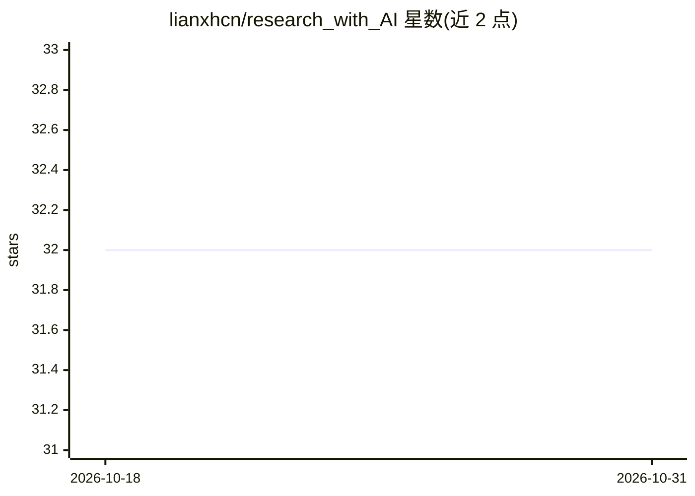

# lianxhcn/research_with_AI

⭐ 32 · Jupyter Notebook · MIT · 推送 2026-01-18 · [GitHub](https://github.com/lianxhcn/research_with_AI) · [官网](https://lianxhcn.github.io/research_with_AI/) · 个人维护 · 中文 README

**面向实证研究者的 AI 工具使用讲义（在线书籍）**

连玉君为「AI 时代如何做实证研究」公开课编写的在线讲义，介绍 ChatGPT、豆包、GitHub Copilot 等 AI 工具如何提升实证研究效率，并讲解 Markdown、Github 与 Jupyter Notebook 的协同工作方式。全书用 VScode + Quarto 编写，经 GitHub Pages 发布；读者可 Fork 仓库并按书中指引完成安装与环境配置后在本地演练。作者另提供 B 站视频回放与小红书账号用于交流，书中内容存在错漏并由作者持续修订。

## 筛选速览

| 维度 | 判定 | 备注 |
|---|---|---|
| AI 角色 | `ai-knowledge` | 知识聚合/清单类 |
| 许可风险 | `permissive` | MIT |
| 部署形态 | `None` |  |
| 模型依赖 | — | README 未给出锁定关系 |
| 硬件要求 | — | 无带数字的原话,不猜 |
| 安装摩擦 | `low` | 无编译、无系统依赖或容器化 |
| 成熟度 | — | 结构信号不足 |

## 能力要点

- 介绍 ChatGPT、豆包、GitHub Copilot 等工具在实证研究中的用法
- 覆盖 Markdown、Github、Jupyter Notebook 协同工作方式
- 基于 VScode + Quarto 编写，经 GitHub Pages 发布
- 可 Fork 仓库后本地演练书中示例

## 适用场景

- 学习如何用 AI 工具辅助实证研究
- 参考 AI 工具与 Markdown/Github/Jupyter 的协同工作流
- 配合公开课视频回放系统学习

## 场景标签

`教程课程` · 领域:学习与行业

## 证据(README 行号)

> L5: 这本书是在准备 连享会系列公开课 中的「AI 时代如何做实证研究？」专题时编写的讲义。
> L10: 书中介绍了 AI 工具如何提升实证研究的效率，如何帮助我们更好地思考和解决问题。书中还介绍了 ChatGPT, 豆包, Github Copilot 等工具的使用，以及 Markdown、Github 和 Jupyter Note

## 星数曲线

2026-10-18 32 → 2026-10-31 32（+0）

---
*卡片 v1 · prompt 1.4 · 生成 2026-10-26 · 置信度 high · 依据 README sha `3fb0bdd07651` · [字段定义](../../DATASET.md)*
