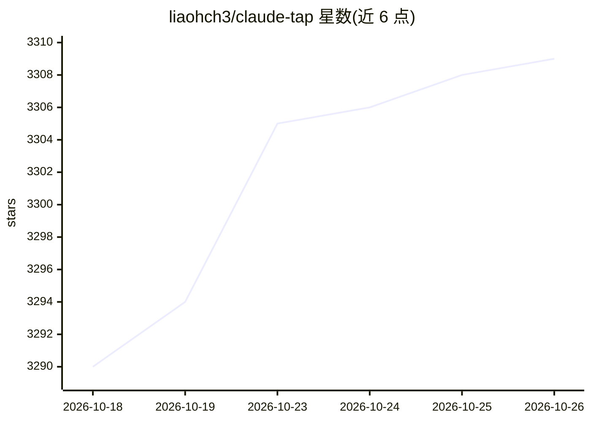

# liaohch3/claude-tap

⭐ 3,309 · Python · MIT · 推送 2026-10-25 · [GitHub](https://github.com/liaohch3/claude-tap) · 个人维护 · 中文 README

**本地代理+追踪查看器：截取并检视 AI 编程 agent 的 API 流量**

面向 AI 编程 agent 开发者的本地流量截取与检视工具：以本地代理方式启动 CLI 客户端（或以正向代理/本地转录监听方式接入桌面应用），记录并展示系统提示词、对话历史、工具 schema 与调用、流式响应、token 用量及相邻请求 diff；每次运行生成可导出为自包含 HTML 的本地追踪会话，常见认证头在记录前被脱敏，无需托管面板。支持 Claude Code、Codex CLI/App、Gemini CLI、Kimi CLI、OpenCode、Cursor CLI 等十余种客户端，以及 AWS Bedrock（含 SigV4 正向代理模式）与 Vertex AI 网关等上游场景。需 Python 3.11+。

## 筛选速览

| 维度 | 判定 | 备注 |
|---|---|---|
| AI 角色 | `ai-ecosystem` | LLM/agent 周边工具 |
| 许可风险 | `permissive` | MIT |
| 部署形态 | `desktop` | 安装包/桌面程序 |
| 模型依赖 | — | README 未给出锁定关系 |
| 硬件要求 | — | 无带数字的原话,不猜 |
| 安装摩擦 | `low` | 无编译、无系统依赖或容器化 |
| 成熟度 | — | 结构信号不足 |

## 能力要点

- 以本地代理截取十余种 AI 编程 CLI/应用的完整 API 请求与响应
- 查看系统提示词、对话历史、工具定义与调用、流式响应与 token 用量
- 相邻请求结构化 diff，定位上下文变化
- 导出自包含 HTML 查看器；认证头记录前脱敏，数据留在本机

## 适用场景

- 调试 AI 编程 agent 行为时核对实际发出的提示词与工具调用
- 比较相邻请求找出导致行为变化的上下文差异
- 把一次 agent 运行导出为可归档分享的 HTML 追踪文件

## 场景标签

`LLM 可观测性` · 领域:评测与运维

## 证据(README 行号)

> L12: `claude-tap` is a local proxy and trace viewer for AI coding agents. Run your CLI through it, or listen to local ap
> L16: It works with Claude Code, Codex CLI, Codex App, Gemini CLI, Grok Build CLI, Kimi CLI, MiMo Code, OpenCode, OpenCla

## 星数曲线

2026-10-18 3,290 → 2026-10-26 3,309（+19）

---
*卡片 v1 · prompt 1.4 · 生成 2026-10-20 · 置信度 high · 依据 README sha `f32a6b6f5610` · [字段定义](../../DATASET.md)*
