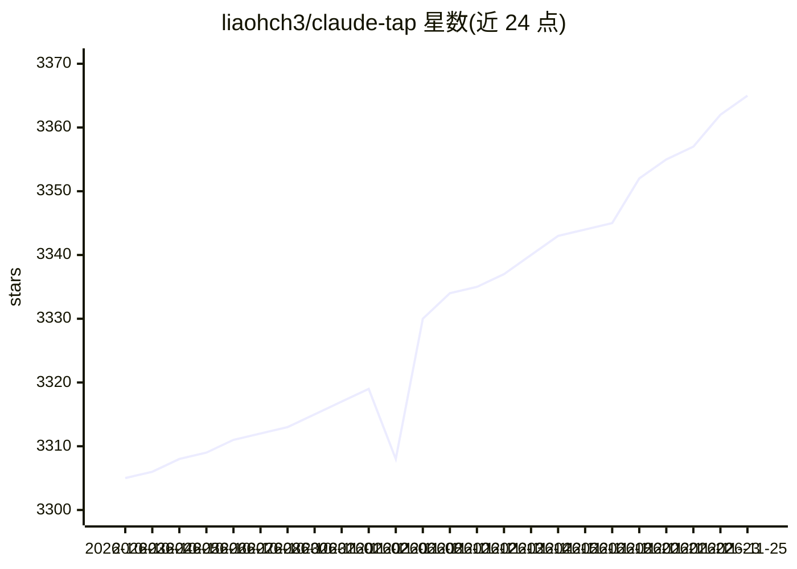

# liaohch3/claude-tap

⭐ 3,365 · Python · MIT · 推送 2026-11-23 · [GitHub](https://github.com/liaohch3/claude-tap) · 个人维护 · 中文 README

**本地代理与 Trace 查看器：检查编码 Agent 的真实 API 流量**

以本地代理形式运行的 AI 编码 Agent 流量捕获与追踪查看工具：将 Claude Code、Codex CLI、Gemini CLI 等客户端经它启动，或监听本地应用 transcript，检查系统提示词、对话历史、工具 schema、工具调用、流式响应、token 用量与相邻请求的 diff。支持反向代理与转发代理两种捕获模式，自动检测环境变量中的上游地址；追踪数据仅存本地，记录前将常见鉴权头替换为 ***，并可导出为自包含 HTML 查看。以 Python 包分发，要求 Python 3.11+ 与被追踪的客户端。

## 筛选速览

| 维度 | 判定 | 备注 |
|---|---|---|
| AI 角色 | `ai-ecosystem` | LLM/agent 周边工具 |
| 许可风险 | `permissive` | MIT |
| 部署形态 | `desktop` | 安装包/桌面程序 |
| 模型依赖 | locked-api |  |
| 硬件要求 | — | 无带数字的原话,不猜 |
| 安装摩擦 | `low` | 无编译、无系统依赖或容器化 |
| 成熟度 | — | 结构信号不足 |

## 能力要点

- 捕获并展示系统提示词、对话历史、工具调用与 token 用量
- 相邻请求结构化 diff，定位上下文变化点
- 自动检测 ANTHROPIC_BASE_URL / BEDROCK / VERTEX 等上游配置
- 追踪仅存本地，鉴权头记录前替换为 ***，可导出为自包含 HTML

## 适用场景

- 调试编码 Agent 时查看每一轮请求的真实上下文变化
- Claude Code 搭配 DeepSeek/Bedrock/Vertex 网关时捕获 API 流量
- 导出 trace HTML 给同事离线审查某次 Agent 运行

## 场景标签

`LLM 可观测性` · 领域:评测与运维

## 证据(README 行号)

> L12: `claude-tap` is a local proxy and trace viewer for AI coding agents. Run your CLI through it, or listen to local ap
> L73: ## Install
> L75: Requires Python 3.11+ and the client you want to trace.

## 星数曲线

2026-10-23 3,305 → 2026-11-25 3,365（+60）

---
*卡片 v1 · prompt 1.4 · 生成 2026-11-23 · 置信度 high · 依据 README sha `980ea46819f8` · [字段定义](../../DATASET.md)*
