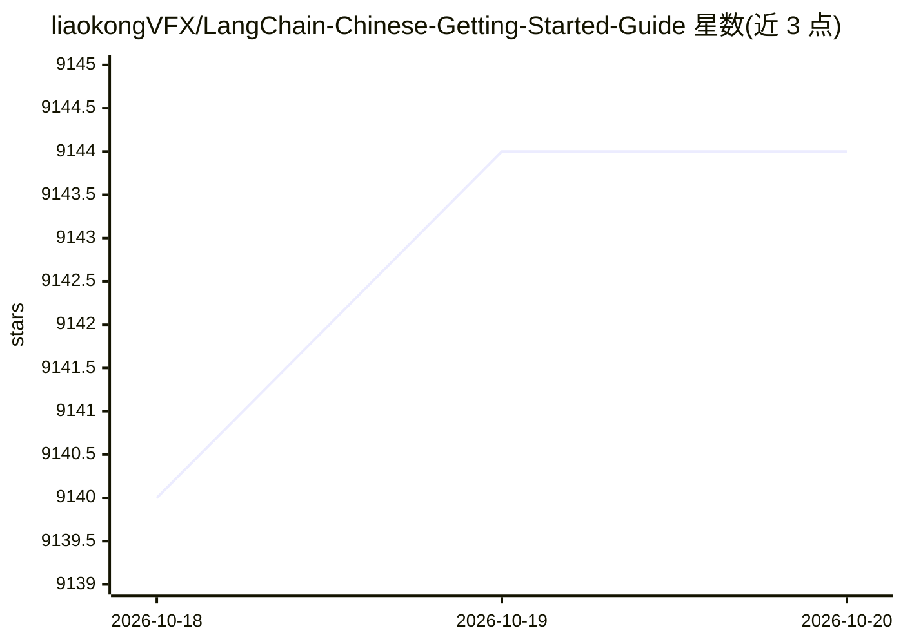

# liaokongVFX/LangChain-Chinese-Getting-Started-Guide

⭐ 9,144 · 推送 2026-04-22 · [GitHub](https://github.com/liaokongVFX/LangChain-Chinese-Getting-Started-Guide) · 个人维护 · 中文 README

**LangChain 中文入门教程：带实战代码的 LLM 应用开发指南**

面向中文读者的 LangChain 入门教程文档，配套 GitBook 与 Colab ipynb 代码。内容涵盖 LangChain 基础概念（Loader/Document/文本分割/向量数据库/Chain/Agent/Embedding）与多个实战案例：联网搜索问答、超长文本总结、本地知识库问答机器人、向量数据持久化（Chroma/Pinecone）、油管视频问答、Zapier 工具连接、结构化输出、带记忆对话机器人及 Hugging Face 模型使用。示例以 OpenAI API 为主，作者声明部分代码可能随库迭代过时，并提供 OPENAI_API_BASE 代理配置方法。

## 筛选速览

| 维度 | 判定 | 备注 |
|---|---|---|
| AI 角色 | `ai-knowledge` | 知识聚合/清单类 |
| 许可风险 | `none` | — |
| 部署形态 | `None` |  |
| 模型依赖 | — | README 未给出锁定关系 |
| 硬件要求 | — | 无带数字的原话,不猜 |
| 安装摩擦 | `low` | 无编译、无系统依赖或容器化 |
| 成熟度 | — | 结构信号不足 |

## 能力要点

- 系统讲解 Loader/Chain/Agent/Embedding 等 LangChain 核心概念
- 本地知识库问答、向量持久化（Chroma/Pinecone）等实战案例
- 全部示例代码以 Colab ipynb 形式提供
- 支持通过 OPENAI_API_BASE 环境变量修改 API 代理地址

## 适用场景

- 中文开发者入门学习 LangChain 框架
- 跟着案例搭建本地知识库问答机器人
- 了解长文本总结、结构化输出、Agent 工具调用等常见模式

## 场景标签

`教程课程` · 领域:学习与行业

## 证据(README 行号)

> L1: # LangChain 中文入门教程
> L26: 众所周知 OpenAI 的 API 无法联网的，所以如果只使用自己的功能实现联网搜索并给出回答、总结 PDF 文档、基于某个 Youtube 视频进行问答等等的功能肯定是无法实现的。所以，我们来介绍一个非常强大的第三方开源库：`L
> L133: ## 实战

## 星数曲线

2026-10-18 9,140 → 2026-10-20 9,144（+4）

---
*卡片 v1 · prompt 1.4 · 生成 2026-10-20 · 置信度 high · 依据 README sha `66f1975101ba` · [字段定义](../../DATASET.md)*
