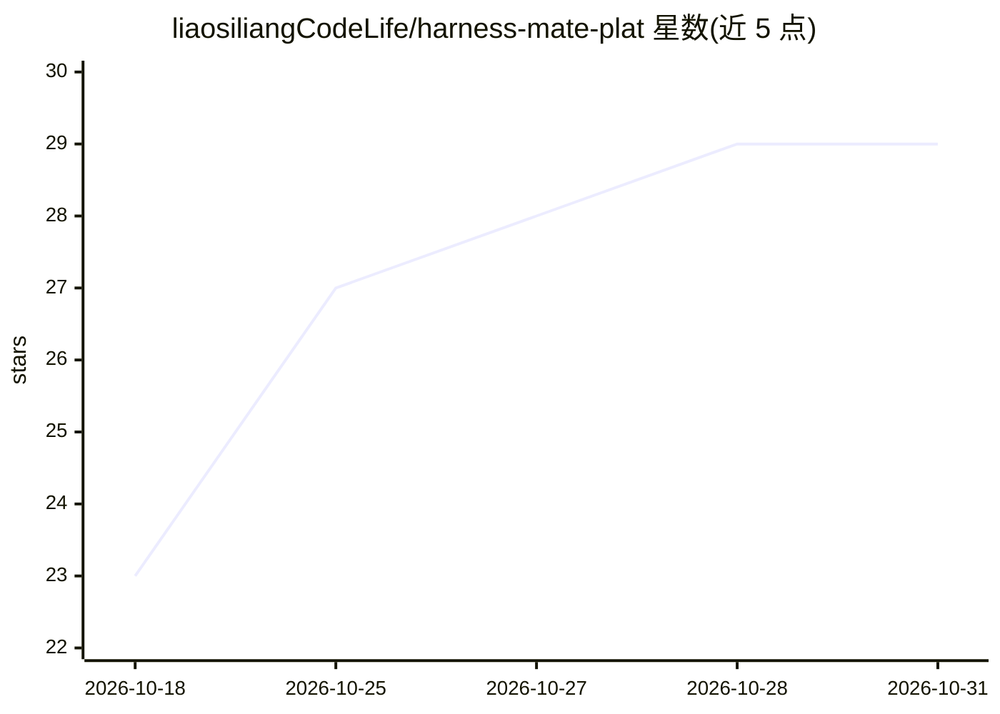

# liaosiliangCodeLife/harness-mate-plat

⭐ 29 · Python · MIT · 推送 2026-10-30 · [GitHub](https://github.com/liaosiliangCodeLife/harness-mate-plat) · [官网](https://harness.alltman.com) · 个人维护 · 中文 README

**把本机 AI Agent 变成多人可用 Web 产品的端到端平台**

由 Vue 3 前端、Flask 后端、Go WebSocket 网关与 Agent 侧插件组成的端到端平台：本机运行的 AI Agent 通过插件接入网关后，其他用户经浏览器与其对话、互传文件。提供邮箱/GitHub 登录、单会话登录、会话与消息落库、在线状态、API Key 开放接口、文件双向传输与 Docker Compose 一键部署（含 Nginx/certbot 证书自动续期）。默认对接 Hermes Agent，通道协议开放，接其他 Agent 需自行实现适配器；生产部署需 PostgreSQL、Redis 与对象存储。

## 筛选速览

| 维度 | 判定 | 备注 |
|---|---|---|
| AI 角色 | `ai-ecosystem` | LLM/agent 周边工具 |
| 许可风险 | `permissive` | MIT |
| 部署形态 | `self-host` | docker 或自建部署 |
| 模型依赖 | — | README 未给出锁定关系 |
| 硬件要求 | — | 无带数字的原话,不猜 |
| 安装摩擦 | `low` | 无编译、无系统依赖或容器化 |
| 成熟度 | — | 结构信号不足 |

## 能力要点

- 浏览器经 WebSocket 网关与本机 Agent 实时收发消息，支持流式输出与中断生成
- 文件图片双向传输：用户上传给 Agent，Agent 回传本地文件并渲染
- 账号体系（邮箱/GitHub OAuth）与单会话登录（Redis 会话标识）
- Docker Compose 单机部署，Nginx + Let's Encrypt 证书自动签发续期

## 适用场景

- 把跑在自己电脑上的 Agent 开放给同事或客户通过浏览器使用
- 为团队提供带账号体系的智能体对话与文件互传服务
- 通过开放接口把本机 Agent 接入现有业务系统
- 多台机器上的多个 Agent 统一管理与在线状态查看

## 场景标签

`聊天机器人` · 领域:对话与助手

## 证据(README 行号)

> L7: **端到端智能体平台 —— 把你自己电脑上的 AI Agent 变成一个人人可用的 Web 产品。**
> L77: - **实时会话** —— 浏览器通过 WebSocket **直连网关**，与 Agent 点对点收发消息；支持流式输出（含思考中状态）与消息落库。
> L97: - **WebSocket 链路（浏览器 ⇄ 网关 ⇄ 插件 ⇄ Agent）**：实时消息与流式回复。网关只做鉴权和点对点转发（按 `ws_session_id` 精确投递），不解析业务内容；Agent 侧插件负责和本机 Age

## 星数曲线

2026-10-18 23 → 2026-10-31 29（+6）

---
*卡片 v1 · prompt 1.4 · 生成 2026-10-26 · 置信度 mid · 依据 README sha `e8bdaaf0ab08` · [字段定义](../../DATASET.md)*
