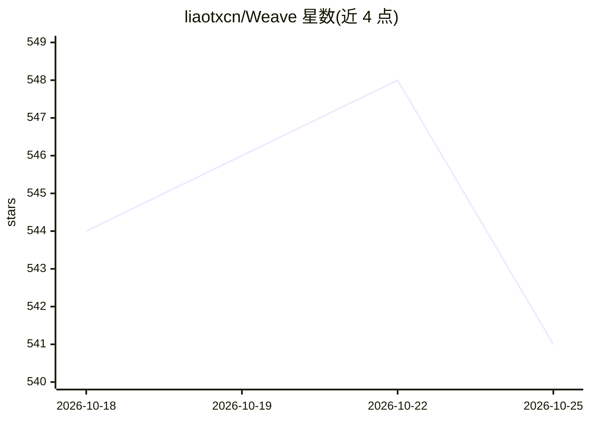

# liaotxcn/Weave

⭐ 541 · Go · 推送 2026-07-15 · [GitHub](https://github.com/liaotxcn/Weave) · [官网](https://github.com/NexusForgeAI/Weave-Toolkit) · 个人维护 · 中文 README

**面向开发者的 Go 应用开发平台，集成 LLM/Agent/RAG 能力**

用 Golang 构建的应用开发平台，采用微内核+分层架构，核心是插件系统：支持插件注册、热插拔、依赖解析、冲突检测与命名空间隔离，并提供脚手架工具生成插件代码。AI 部分集成了 LLM、AIChat、Agent、RAG 功能栈：兼容 OpenAI、Ollama、ModelScope 等多模型并支持动态切换；RAG 基于 RedisSearch 向量检索，支持多格式文档处理。还包含 JWT 认证、限流、Prometheus/Grafana 监控，支持本地开发与 Docker 部署。面向需要构建智能应用的开发者。

## 筛选速览

| 维度 | 判定 | 备注 |
|---|---|---|
| AI 角色 | `ai-ecosystem` | LLM/agent 周边工具 |
| 许可风险 | `none` | — |
| 部署形态 | `self-host` | docker 或自建部署 |
| 模型依赖 | local-ok | 支持本地模型 |
| 硬件要求 | — | 无带数字的原话,不猜 |
| 安装摩擦 | `low` | 无编译、无系统依赖或容器化 |
| 成熟度 | — | 结构信号不足 |

## 能力要点

- 微内核+分层架构，插件支持热插拔与依赖/冲突管理
- 集成 LLM/AIChat/Agent/RAG 功能栈，兼容 OpenAI/Ollama/ModelScope 多模型动态切换
- 基于 RedisSearch 的向量检索 RAG，支持文本/PDF/Markdown 等多格式文档
- 插件脚手架工具与示例插件，支持本地开发和 Docker 部署

## 适用场景

- 以插件方式开发并聚合工具与服务应用
- 构建带 LLM 对话、Agent 与 RAG 的智能应用
- 作为 API 网关或数据/服务流中间平台
- 结合 ETL、DevOps 与 Agent 搭建自动化工作流

## 场景标签

`RAG` `Agent 框架` · 领域:Agent 开发

## 证据(README 行号)

> L13: Weave (meaning "to weave") – from a simple thread to a complex tapestry, weaving is the creative process from simpl
> L17: Weave's core strength lies in its stable and reliable **AI feature development stack + plugin/tool system**, deeply
> L96: - **Complete AI Functional Stack**: Integrates core AI capabilities like LLM (Large Language Models), AIChat (Intel

## 星数曲线

2026-10-18 544 → 2026-10-25 541（-3）

---
*卡片 v1 · prompt 1.4 · 生成 2026-10-21 · 置信度 mid · 依据 README sha `c2fb3ea1e5f6` · [字段定义](../../DATASET.md)*
