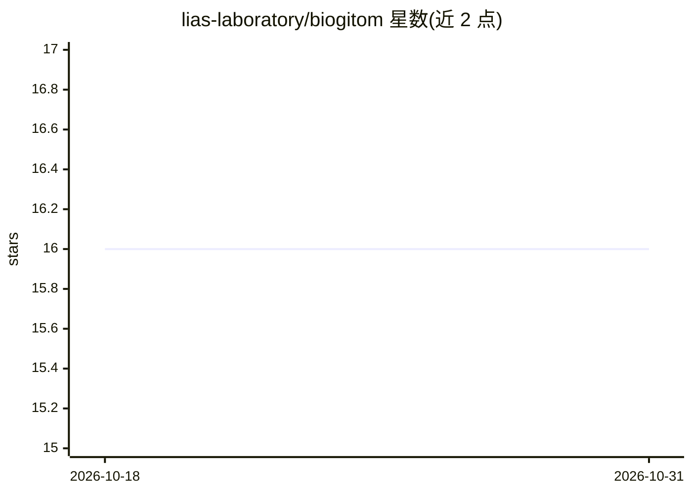

# lias-laboratory/biogitom

⭐ 16 · Jupyter Notebook · MIT · 推送 2026-07-09 · [GitHub](https://github.com/lias-laboratory/biogitom) · 组织维护

**生物医学本体匹配系统：GIT 混合模型生成概念映射**

面向生物医学本体匹配任务的系统：用 SapBERT 提取领域语义嵌入，再结合 Graph Isomorphism Transformer（融合 GIN 与 Graph Transformer）提取结构特征，生成概念表示并输出本体间映射。仓库包含训练集构建与嵌入生成脚本、Bio-ML 数据集与参考对齐、消融等实验结果、各任务子目录（数据/脚本/结果），以及 run_biogitom.py 统一执行入口和 create_new_task.py 新任务自动搭建脚本。安装与复现细节分别指向独立指南文档。

## 筛选速览

| 维度 | 判定 | 备注 |
|---|---|---|
| AI 角色 | `ai-native` | 本体是模型或模型工具 |
| 许可风险 | `permissive` | MIT |
| 部署形态 | `None` |  |
| 模型依赖 | — | README 未给出锁定关系 |
| 硬件要求 | — | 无带数字的原话,不猜 |
| 安装摩擦 | `low` | 无编译、无系统依赖或容器化 |
| 成熟度 | — | 结构信号不足 |

## 能力要点

- SapBERT 语义嵌入 + GIT（GIN 与 Graph Transformer 混合）结构特征的双路表示
- run_biogitom.py 按输入参数定位并执行任务脚本
- create_new_task.py 自动完成新任务的嵌入生成与映射产出
- 附 Bio-ML 数据集、实验结果与可复现指南

## 适用场景

- 在 Bio-ML 任务上运行本体匹配并复现已发布结果
- 为本体对齐任务生成语义嵌入与结构特征
- 搭建新的本体匹配任务并生成映射

## 场景标签

`知识图谱` · 领域:知识与检索

## 证据(README 行号)

> L3: **BioGITOM** is a specialized ontology matching system designed to tackle the increasing complexity and heterogeneit
> L5: To address these challenges, BioGITOM enhances domain-specific embeddings extracted using the SapBERT model with str

## 星数曲线

2026-10-18 16 → 2026-10-31 16（+0）

---
*卡片 v1 · prompt 1.4 · 生成 2026-10-30 · 置信度 high · 依据 README sha `c87114dc00fd` · [字段定义](../../DATASET.md)*
