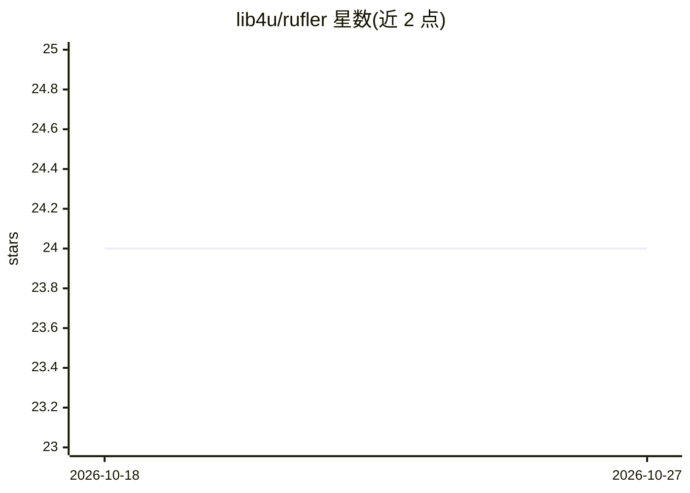

# lib4u/rufler

⭐ 24 · Python · 推送 2026-04-21 · [GitHub](https://github.com/lib4u/rufler) · 个人维护

**把 ruflo 多命令引导封装为单个 YAML 的 Claude 群集编排工具**

rufler 是围绕 TypeScript 编排 CLI ruflo（claude-flow 家族）的 Python 封装：用一份声明式 rufler_flow.yml 描述项目、agent 团队与任务，`rufler run` 一条命令完成检查、init、daemon、memory、swarm、hive-mind 到 spawn 的完整流程。面向日常驱动 Claude Code 自治群集的开发者，提供任务分解（调用 `claude -p`）、多任务串/并行、断点续跑、token 统计、NDJSON 日志与 `follow` 实时面板、MCP server 注册与 skills.sh 集成。前置依赖为 Python 3.9+、Node.js 20+、Claude Code CLI 与 ruflo，暂未上架 PyPI，需从源码安装。

## 筛选速览

| 维度 | 判定 | 备注 |
|---|---|---|
| AI 角色 | `ai-ecosystem` | LLM/agent 周边工具 |
| 许可风险 | `none` | — |
| 部署形态 | `self-host` | docker 或自建部署 |
| 模型依赖 | — | README 未给出锁定关系 |
| 硬件要求 | — | 无带数字的原话,不猜 |
| 安装摩擦 | `low` | 无编译、无系统依赖或容器化 |
| 成熟度 | — | 结构信号不足 |

## 能力要点

- 单命令 `rufler run` 串联 ruflo 全部 init/spawn 流程
- AI 任务分解与 Deep Think 项目分析（调用 claude -p，默认 opus）
- 跨项目 run 注册表、token 统计、断点续跑与迭代精炼（iterations + judge agent）
- MCP server 声明式注册与 skills.sh 技能安装集成

## 适用场景

- 用一份 YAML 管理 Claude Code 多 agent 群集的启动与生命周期
- 把大任务交给 Claude 分解后在群集中串/并行执行并续跑
- 跨项目追踪各次运行的 token 消耗与任务状态

## 场景标签

`多智能体` `编码 Agent` · 领域:Agent 开发

## 证据(README 行号)

> L5: `rufler` is a Python wrapper around `ruflo` (the TypeScript AI agent orchestration CLI from the `claude-flow` family
> L13: rufler handles preflight checks, daemon lifecycle, swarm/memory/hive-mind init, objective composition, logging, mul

## 星数曲线

2026-10-18 24 → 2026-10-27 24（+0）

---
*卡片 v1 · prompt 1.4 · 生成 2026-10-27 · 置信度 mid · 依据 README sha `d31bf14212de` · [字段定义](../../DATASET.md)*
