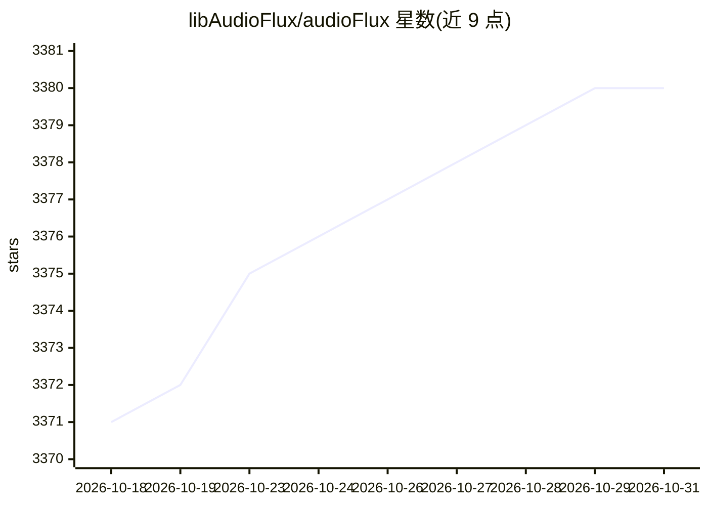

# libAudioFlux/audioFlux

⭐ 3,380 · C · MIT · 推送 2026-03-06 · [GitHub](https://github.com/libAudioFlux/audioFlux) · [官网](https://audioflux.top) · 组织维护

**面向深度学习的音频与音乐分析、特征提取库**

audioFlux 是用于音频与音乐分析及特征提取的库，基于数据流设计，提供数十种时频变换（BFT/CWT/CQT/DWT 等）、频谱/倒谱/色度特征及 MIR 模块（pitch、onset、hpss），可输出多维特征组合供深度学习网络训练，用于分类、分离、MIR、ASR 等任务。支持 Linux/macOS/Windows/iOS/Android，经 PyPI 与 conda 安装，MIT 许可。

## 筛选速览

| 维度 | 判定 | 备注 |
|---|---|---|
| AI 角色 | `ai-native` | 本体是模型或模型工具 |
| 许可风险 | `permissive` | MIT |
| 部署形态 | `library` | 以包/库形式分发 |
| 模型依赖 | — | README 未给出锁定关系 |
| 硬件要求 | — | 无带数字的原话,不猜 |
| 安装摩擦 | `low` | 无编译、无系统依赖或容器化 |
| 成熟度 | — | 结构信号不足 |

## 能力要点

- 数十种时频变换与多种频率尺度类型（Linear/Mel/Bark/Octave 等）
- 数百种时域/频域特征组合，供深度学习网络训练
- MIR 模块含 pitch、onset、hpss 算法，含多种 Pitch 算法
- 跨平台支持 Linux/macOS/Windows/iOS/Android

## 适用场景

- 为分类、分离、MIR、ASR 任务提取音频特征
- 生成 Mel/MFCC、CQT/Chroma 等频谱特征用于模型训练
- 乐器调音器与音高估计应用开发

## 场景标签

 · 领域:音频/音乐信息检索

## 证据(README 行号)

> L13: **`audioflux`** is a deep learning tool library for audio and music analysis, feature extraction. It supports dozen
> L15: combinations. It can be provided to deep learning networks for training, and is used to study various tasks in the 

## 星数曲线

2026-10-18 3,371 → 2026-10-31 3,380（+9）

---
*卡片 v1 · prompt 1.4 · 生成 2026-10-20 · 置信度 high · 依据 README sha `7b6189942e66` · [字段定义](../../DATASET.md)*
