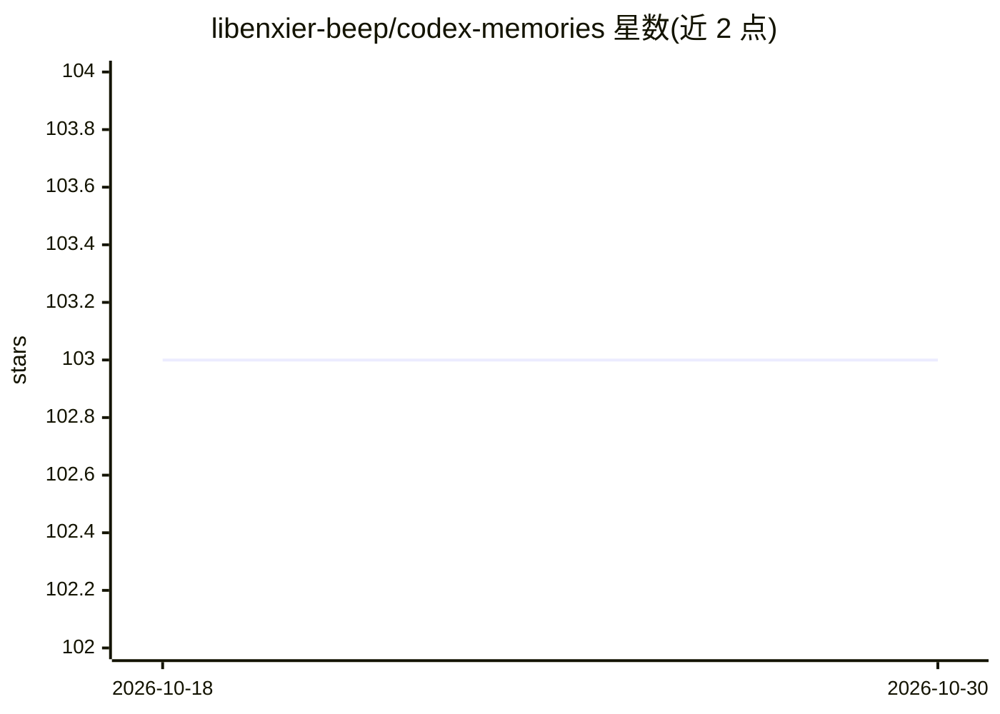

# libenxier-beep/codex-memories

⭐ 103 · Python · Apache-2.0 · 推送 2026-09-10 · [GitHub](https://github.com/libenxier-beep/codex-memories) · 个人维护 · 中文 README

**给 OpenAI Codex 的本地持久记忆运行时：Git 权威+渐进披露**

面向开发者的本地优先 AI agent 记忆运行时，让 Codex 跨会话记住事实、决策与偏好。机制上组合 Git 权威存储、本地 SQLite sidecar、有界混合检索与最多三轮的渐进披露循环，由当前 Codex 模型担任规划者，不启动嵌套 LLM。通过 Codex 生命周期 hook 捕获与召回，检索文本被视为不可信数据，需从 Git 权威重开后方可进入上下文。无需托管向量数据库；状态为 advanced preview，隐藏评测未通过（3/6 rejected），大规模独立评测未执行；Windows 未验证。

## 筛选速览

| 维度 | 判定 | 备注 |
|---|---|---|
| AI 角色 | `ai-ecosystem` | LLM/agent 周边工具 |
| 许可风险 | `permissive` | Apache-2.0 |
| 部署形态 | `None` |  |
| 模型依赖 | — | README 未给出锁定关系 |
| 硬件要求 | — | 无带数字的原话,不猜 |
| 安装摩擦 | `low` | 无编译、无系统依赖或容器化 |
| 成熟度 | `idea` | |

## 能力要点

- Git 权威 + 本地 SQLite sidecar + 三轮有界渐进披露检索
- 通过 SessionStart/UserPromptSubmit/tool/stop hook 集成 Codex 生命周期
- 本地优先：记忆、索引、授权状态留在本机，无需托管向量数据库
- fail-closed 生命周期检查（scope/隐私/删除/tombstone/来源/内容哈希）

## 适用场景

- 让 Codex 在跨会话中记住项目决策与偏好且不外传记忆数据
- 在本地以 Git 管理私有记忆库并可控审查 hook 集成
- 替代堆 context 或自建向量数据库栈的轻量记忆方案

## 场景标签

`Agent 记忆` · 领域:Agent 开发

## 证据(README 行号)

> L46: Codex Memories is a local-first **AI agent memory** runtime for developers who
> L100: - **Native Codex lifecycle integration** — capture and recall through
> L104: - **The current Codex model is the planner** — no nested agent or second remote

## 星数曲线

2026-10-18 103 → 2026-10-30 103（+0）

---
*卡片 v1 · prompt 1.4 · 生成 2026-10-23 · 置信度 high · 依据 README sha `58584ba5d469` · [字段定义](../../DATASET.md)*
