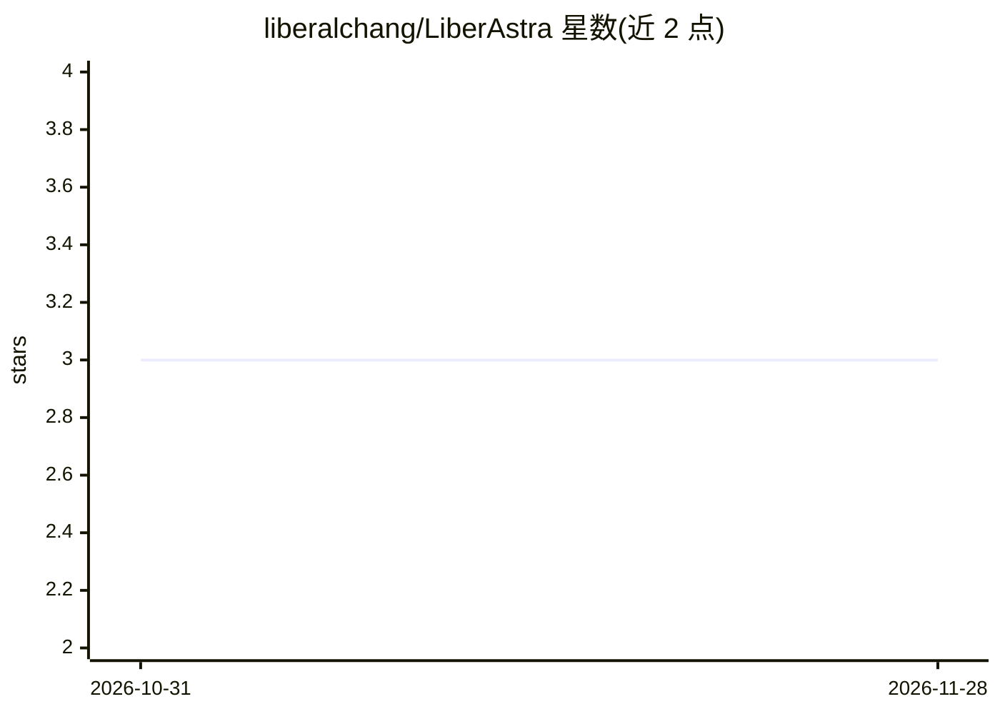

# liberalchang/LiberAstra

⭐ 3 · Python · MIT · 推送 2026-11-14 · [GitHub](https://github.com/liberalchang/LiberAstra) · [官网](https://liberalchang.github.io/LiberAstra/) · 个人维护 · 中文 README

**自托管 AIGC 编排台：统一接入 ComfyUI/Ollama/语音服务**

不自带模型推理的自托管编排工作台，把用户自备的 ComfyUI、Ollama 与语音服务接到同一界面，覆盖文生图、图生图、视频流水线（口播分镜、数字人、图生视频）、TTS/ASR 与拼接工具，并提供无限画布把节点连成可执行流程。提供 Web（中英文）、astra CLI、MCP Server、OpenAI 兼容 /v1 四种入口；编排进程与显卡可分属不同机器；通过 docker compose 或 Windows 安装包安装，需自行配置服务提供方地址与模型。

## 筛选速览

| 维度 | 判定 | 备注 |
|---|---|---|
| AI 角色 | `ai-ecosystem` | LLM/agent 周边工具 |
| 许可风险 | `permissive` | MIT |
| 部署形态 | `desktop` | 安装包/桌面程序 |
| 模型依赖 | local-ok | 支持本地模型 |
| 硬件要求 | `cpu-ok` | |
| 安装摩擦 | `low` | 无编译、无系统依赖或容器化 |
| 成熟度 | — | 结构信号不足 |

## 能力要点

- 四种接入入口：Web UI、astra CLI、MCP Server、OpenAI 兼容 /v1
- 无限画布将输入、工作流包、语音与拼接工具连成流程并按节点执行
- 编排进程不需要 GPU，可与 ComfyUI/Ollama 主机分置部署
- 支持导入 Comfy 工作流图，内置图像/视频工作流包

## 适用场景

- 在局域网一台机器编排另一台显卡主机上的 ComfyUI 出图出视频
- 用口播文案批量生成带配音字幕的视频短片
- 通过 OpenAI 兼容接口把自托管图像/语音服务接入其他应用
- 在 Claude/Cursor 里通过 MCP 调用本机 AIGC 流程

## 场景标签

`模型网关` `工作流自动化` `图像生成` `视频生成` · 领域:Agent 开发

## 证据(README 行号)

> L12: 只编排、不推理：把 ComfyUI、Ollama 和语音接到同一个工作台（Web / CLI / MCP / OpenAI `/v1`）。
> L30: 需要自备 ComfyUI、Ollama，或兼容的云端 API。LiberAstra 不替代它们，也不内置模型。
> L70: |模型在哪跑|不跑，交给外部服务|在本机执行图|通常是云端或本地 LLM|

## 星数曲线

2026-10-31 3 → 2026-11-28 3（+0）

---
*卡片 v1 · prompt 1.4 · 生成 2026-11-21 · 置信度 mid · 依据 README sha `e5fd51c2f1ef` · [字段定义](../../DATASET.md)*
