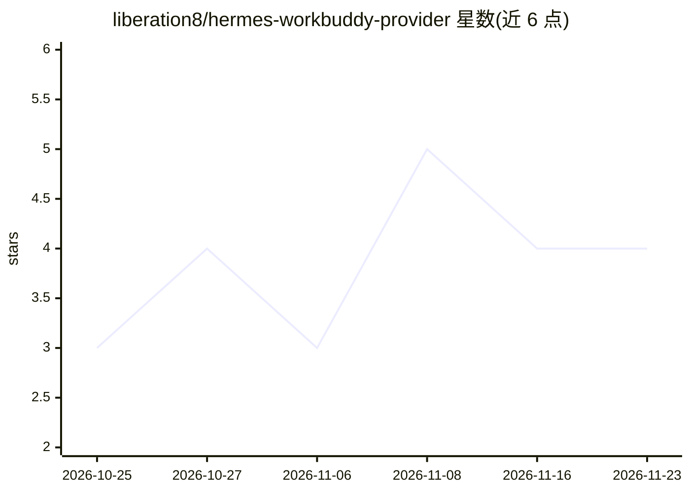

# liberation8/hermes-workbuddy-provider

⭐ 4 · JavaScript · MIT · 推送 2026-10-31 · [GitHub](https://github.com/liberation8/hermes-workbuddy-provider) · 个人维护 · 中文 README

**把 WorkBuddy 订阅接成本地 OpenAI 兼容反代供各客户端调用**

读取 WorkBuddy AI 桌面端加密存储的登录凭据并自动解密刷新，在 127.0.0.1:8788 暴露一个零依赖的 Node 本地服务，提供 /v1/chat/completions（流式/非流式）与 /v1/models 等 OpenAI 兼容端点，任何接受 base_url+api_key 的客户端均可访问其 27 个模型。内置限速退避（800ms 最小间隔）、错误分类映射、凭据诊断脚本与自带 mock 上游的回归测试。前置条件为 Node.js ≥22、已登录的 WorkBuddy 桌面端，且凭据解密仅实现了 Windows 路径。

## 筛选速览

| 维度 | 判定 | 备注 |
|---|---|---|
| AI 角色 | `ai-ecosystem` | LLM/agent 周边工具 |
| 许可风险 | `permissive` | MIT |
| 部署形态 | `desktop` | 安装包/桌面程序 |
| 模型依赖 | — | README 未给出锁定关系 |
| 硬件要求 | — | 无带数字的原话,不猜 |
| 安装摩擦 | `low` | 无编译、无系统依赖或容器化 |
| 成熟度 | — | 结构信号不足 |

## 能力要点

- 解密 WorkBuddy 凭据库并单飞（single-flight）自动刷新，无需手动复制 token
- OpenAI 兼容端点：/v1/chat/completions 流式与非流式、/v1/models、支持 tools/tool_calls
- 限速与指数退避（800ms 间隔、2 req/s 上限），四类上游错误映射为明确错误类型
- 自带 mock 上游回归测试套件，无需真实账号即可验证

## 适用场景

- 让 Hermes 通过本地反代调用 WorkBuddy 订阅内的模型
- 用 OpenAI SDK / Cherry Studio 等兼容客户端接入 base_url 即用
- 排查订阅账号配额、限流、封禁等上游错误原因

## 场景标签

`模型网关` · 领域:Agent 开发

## 证据(README 行号)

> L14: The WorkBuddy desktop app keeps your login encrypted on disk. This project decrypts it and exposes a local, **zero-
> L30: |**OpenAI compatible**|`/v1/chat/completions` (streaming + non-streaming), `/v1/models`.|
> L44: - Windows (the credential vault paths are implemented for the Windows layout — see Platform support)

## 星数曲线

2026-10-25 3 → 2026-11-23 4（+1）

---
*卡片 v1 · prompt 1.4 · 生成 2026-11-21 · 置信度 high · 依据 README sha `e9936a45f1b0` · [字段定义](../../DATASET.md)*
