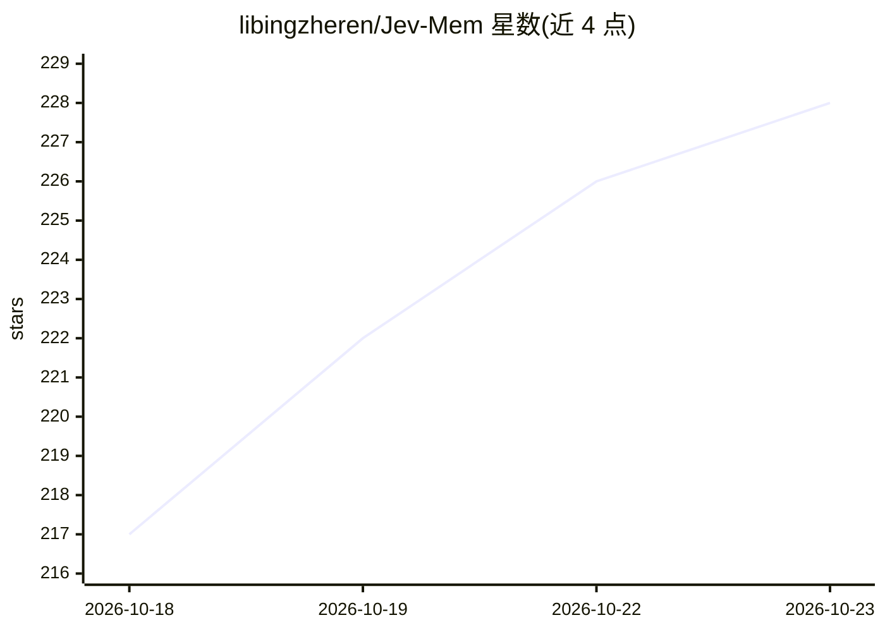

# libingzheren/Jev-Mem

⭐ 228 · Python · MIT · 推送 2026-09-28 · [GitHub](https://github.com/libingzheren/Jev-Mem) · 个人维护

**长时运行 AI agent 的双层记忆系统：快速控制+推理作答**

面向持久化 agent 的记忆管理框架：轻量 System-One 控制器负责记忆写入、关系判断、查询路由与预算分配，System-Two 语言模型基于检索证据合成回答。记忆以语义/时间/因果/实体四类图视图组织，决策过程可通过 trace 检查。默认经 Jev API（需 TypeSafe key）决策，也可用本地 Laya（PyTorch/MLX）替代；回答模型走 OpenAI 兼容接口。提供 demo（无需 API key）、LoCoMo/LongMemEval 基准 runner 与 Python 集成接口；README 明确示例命令不完整复现论文评测，Laya 未做基准测试。

## 筛选速览

| 维度 | 判定 | 备注 |
|---|---|---|
| AI 角色 | `ai-ecosystem` | LLM/agent 周边工具 |
| 许可风险 | `permissive` | MIT |
| 部署形态 | `library` | 以包/库形式分发 |
| 模型依赖 | — | README 未给出锁定关系 |
| 硬件要求 | — | 无带数字的原话,不猜 |
| 安装摩擦 | `low` | 无编译、无系统依赖或容器化 |
| 成熟度 | — | 结构信号不足 |

## 能力要点

- System-One/System-Two 分离：轻量控制器做记忆决策，LLM 做答案合成
- 四类关系图视图（语义/时间/因果/实体）与混合检索
- 决策过程可检查：trace 暴露路由、预算、停止原因与缓存命中
- 决策后端可换：Jev API 或本地 Laya（PyTorch/Apple Silicon MLX）

## 适用场景

- 为长期运行的 agent 构建可追溯的多关系记忆
- 在 LoCoMo/LongMemEval 上评测记忆系统
- 通过 JevMemSystem 接口把记忆管线集成进自己的 Python 应用

## 场景标签

`Agent 记忆` · 领域:Agent 开发

## 证据(README 行号)

> L13: Jev-Mem separates the frequent decisions of memory management from the deeper
> L106: |**System One: memory control**|Memory typing, relation judgments, query routing, budget allocation, candidate sco
> L292: For Python integration, import `JevMemSystem` and `JevMemConfig` from `jev_mem`.

## 星数曲线

2026-10-18 217 → 2026-10-23 228（+11）

---
*卡片 v1 · prompt 1.4 · 生成 2026-10-22 · 置信度 high · 依据 README sha `5f0ce24c4d1a` · [字段定义](../../DATASET.md)*
