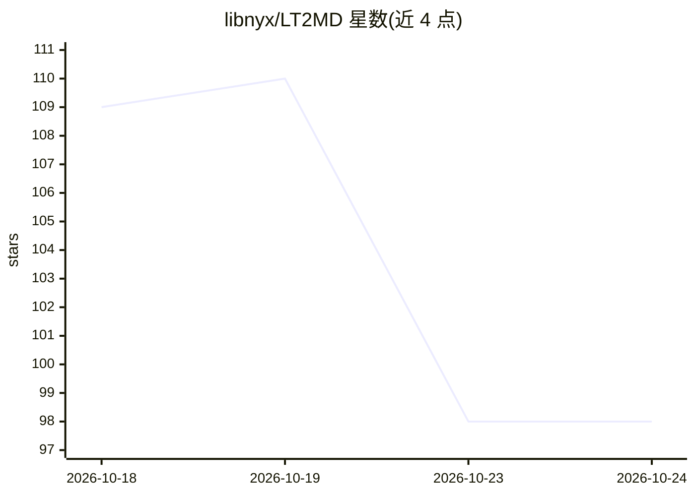

# libnyx/LT2MD

⭐ 98 · Python · AGPL-3.0 · 推送 2026-08-23 · [GitHub](https://github.com/libnyx/LT2MD) · 个人维护 · 中文 README

**给 AI agent 用的技能：把 PDF 转成可溯源 Markdown 并修复旧转换**

面向 AI agent（Claude Code、Codex 等）的文档转换技能：把长篇、扫描、公式图表密集的 PDF 转成可复用的 Markdown，流程为锁定范围→逐页渲染成图→分批转录→独立内容复审→风险点三读→格式校验→合并交付；每个块标注 PDF 页码，流程图/图表信息以文字形式写在题注旁，后续纯文本模型即可阅读，无需再次读取图片。还支持将已有的旧 Markdown 作为候选稿对照 PDF 逐块核查并重识别错误、遗漏与乱序段落。依赖仅 Python 与 pypdfium2、Pillow，无需专用 OCR 引擎；质量依赖宿主模型的图像理解能力。

## 筛选速览

| 维度 | 判定 | 备注 |
|---|---|---|
| AI 角色 | `ai-ecosystem` | LLM/agent 周边工具 |
| 许可风险 | `viral` | AGPL-3.0 |
| 部署形态 | `None` |  |
| 模型依赖 | — | README 未给出锁定关系 |
| 硬件要求 | `cpu-ok` | |
| 安装摩擦 | `low` | 无编译、无系统依赖或容器化 |
| 成熟度 | — | 结构信号不足 |

## 能力要点

- 分批转换+独立复审+风险三读的七步校验流程，支持数百页长文档
- 流程图/图表信息转写为题注旁文字，后续纯文本模型即可读取
- 每段落/公式/图片标注 PDF 页码，可回溯源页
- 可对照 PDF 修复此前转换的旧 Markdown

## 适用场景

- 把公式密集的教材或题库 PDF 转成 Markdown 后供 AI 反复提问，节省重复读图的 token
- 核对并修复之前用其他工具转出的不可信 Markdown
- 把满是流程图的资料转成可检索的知识库
- 处理无文字层的扫描件与旧档案

## 场景标签

`文档解析` · 领域:知识与检索

## 证据(README 行号)

> L9: LT2MD is a skill for AI agents. It does two things. It converts a PDF into Markdown you can reuse and trace back to 
> L88: git clone https://github.com/libnyx/LT2MD.git $env:USERPROFILE\.claude\skills\LT2MD

## 星数曲线

2026-10-18 109 → 2026-10-24 98（-11）

---
*卡片 v1 · prompt 1.4 · 生成 2026-10-23 · 置信度 high · 依据 README sha `89710446db06` · [字段定义](../../DATASET.md)*
