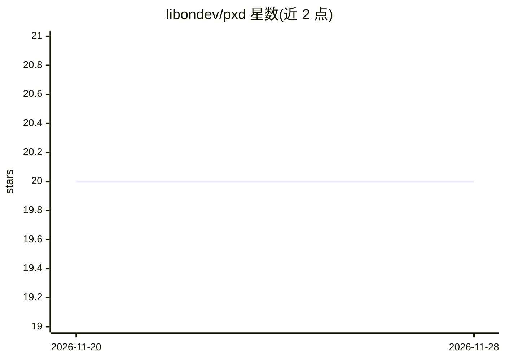

# libondev/pxd

⭐ 20 · TypeScript · MIT · 推送 2026-11-27 · [GitHub](https://github.com/libondev/pxd) · [官网](https://pxd.libondev.cn/) · 个人维护 · 中文 README

**Vue 3.3+ 组件库：提供 agent bridge 让 AI 驱动 UI**

面向 Vue 3.3+ 的 UI 组件库，内置明暗主题（CSS 变量、单类切换）、PC 与移动端适配、动画关闭模式、焦点陷阱与 ARIA 无障碍支持，ESM-only 全 tree-shaking。核心特色为 pxd/agent 桥接层：AI agent 通过 snapshot/act/query 读取并操作组件，支持 WebMCP 注册、逐步 allow 策略门控、密钥脱敏与可观测性，禁用控件会被拒绝。开发者可从源码用 pnpm 构建。项目声明处于活跃开发中，尚未可用于生产。

## 筛选速览

| 维度 | 判定 | 备注 |
|---|---|---|
| AI 角色 | `ai-enhanced` | 去掉 AI 部分产品仍成立 |
| 许可风险 | `permissive` | MIT |
| 部署形态 | `library` | 以包/库形式分发 |
| 模型依赖 | — | README 未给出锁定关系 |
| 硬件要求 | — | 无带数字的原话,不猜 |
| 安装摩擦 | `low` | 无编译、无系统依赖或容器化 |
| 成熟度 | `idea` | |

## 能力要点

- pxd/agent 提供 snapshot/act/query 桥接，支持 WebMCP 注册与逐步策略门控
- 密钥字段在快照与变更流中自动脱敏，禁用控件被拒绝操作
- 明暗主题为纯 CSS 变量，支持 prefers-reduced-motion 与动画关闭
- ESM-only 全 tree-shaking，含 TypeScript 类型与自动导入 resolver

## 适用场景

- 构建支持 AI agent 直接操作界面的 Vue 应用
- 开发带聊天/推理 UI 组件的前端项目
- 需要明暗主题与移动端适配的设计系统

## 场景标签

 · 领域:前端开发/组件库

## 证据(README 行号)

> L3: A universal UI component library for Vue 3.3+. Built-in light/dark theme, PC & mobile ready, animation-free mode sup
> L16: - 🤖 **Agent-ready**: `pxd/agent` exposes components to AI agents through `snapshot` / `act` / `query`, with WebMCP 

## 星数曲线

2026-11-20 20 → 2026-11-28 20（+0）

---
*卡片 v1 · prompt 1.4 · 生成 2026-11-20 · 置信度 high · 依据 README sha `5e71be0233c8` · [字段定义](../../DATASET.md)*
