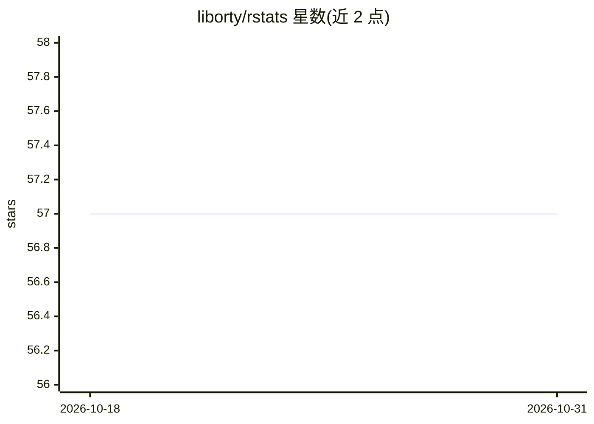

# liborty/rstats

⭐ 57 · Rust · Apache-2.0 · 推送 2026-08-22 · [GitHub](https://github.com/liborty/rstats) · 个人维护

**面向数据分析与机器学习的 Rust 统计与线性代数库**

以 100% safe Rust 编写的 Rust crate，合并统计、信息论、集合论与线性代数于统一抽象（均作用于 Rust Vec 数据对象）。提供基础统计度量、向量/线性代数（含 Cholesky、Householder QR 分解）、不规则矩阵与三角矩阵结构，以及围绕几何中位数（gm）构建的多维数据分析概念：madgm、tm_statistic、contribution、comediance、inner/outer hull、depth、signature vector 等，并提供多线程并行版本的几何中位数算法。通过 crates.io 分发，测试即示例。

## 筛选速览

| 维度 | 判定 | 备注 |
|---|---|---|
| AI 角色 | `ai-native` | 本体是模型或模型工具 |
| 许可风险 | `permissive` | Apache-2.0 |
| 部署形态 | `library` | 以包/库形式分发 |
| 模型依赖 | — | README 未给出锁定关系 |
| 硬件要求 | — | 无带数字的原话,不猜 |
| 安装摩擦 | `low` | 无编译、无系统依赖或容器化 |
| 成熟度 | — | 结构信号不足 |

## 能力要点

- 几何中位数（gm）快速算法及并行版本 gmedian/par_gmedian/wgmedian/par_wgmedian
- 原创多维分析概念：madgm、tm_statistic、comediance、inner/outer hull、depth、sigvec
- 统计、信息论、集合论、线性代数合并于统一 crate，支持不规则矩阵与三角矩阵
- 100% safe Rust 实现

## 适用场景

- 在 Rust 项目中做多维数据的稳健统计特征化
- 以几何中位数替代质心进行抗离群点的数据分析
- 为机器学习数据集做中心、离散度与贡献度度量

## 场景标签

 · 领域:数学/统计计算库

## 证据(README 行号)

> L55: `Rstats` has a small footprint. Only the best methods are implemented, primarily with Data Analysis and Machine Lea
> L7: This crate is written in 100% safe Rust.

## 星数曲线

2026-10-18 57 → 2026-10-31 57（+0）

---
*卡片 v1 · prompt 1.4 · 生成 2026-10-24 · 置信度 mid · 依据 README sha `1559b386866f` · [字段定义](../../DATASET.md)*
