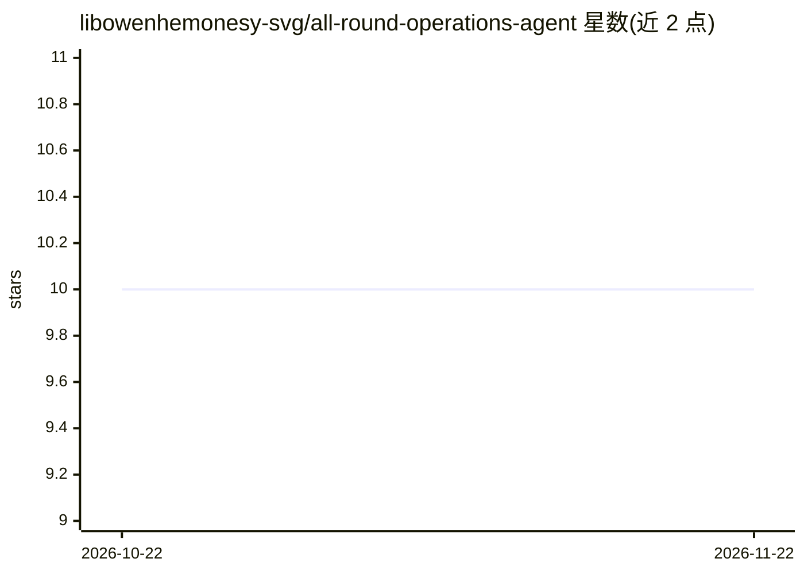

# libowenhemonesy-svg/all-round-operations-agent

⭐ 10 · Python · MIT · 推送 2026-09-12 · [GitHub](https://github.com/libowenhemonesy-svg/all-round-operations-agent) · 个人维护 · 中文 README

**为 Amazon 跨境卖家提供 AI 运营分析与诊断平台**

基于 FastAPI 与 LangGraph 的跨境电商运营分析平台，面向 Amazon 卖家。核心机制包括：CSV/Excel 批量导入 SKU、销售、广告、库存等数据；AI 助手通过 DeepSeek API 对话查询数据并给出分析建议；内置竞品分析、产品健康度诊断、销售异常监控、广告与库存分析工具；支持对接易仓 ERP、亚马逊 SP-API、飞书多维表格，并附 Chrome 扩展采集商品页字段与 RAG 知识库文档导入。部署支持 Render 与 Docker。

## 筛选速览

| 维度 | 判定 | 备注 |
|---|---|---|
| AI 角色 | `ai-native` | 本体是模型或模型工具 |
| 许可风险 | `permissive` | MIT |
| 部署形态 | `library` | 以包/库形式分发 |
| 模型依赖 | locked-api |  |
| 硬件要求 | — | 无带数字的原话,不猜 |
| 安装摩擦 | `low` | 无编译、无系统依赖或容器化 |
| 成熟度 | — | 结构信号不足 |

## 能力要点

- AI 助手对话查询运营数据并合并本地查询工具与卖家精灵 MCP 工具
- 竞品分析、健康度诊断、销售监控、广告与库存分析工具集
- 对接易仓 ERP、亚马逊 SP-API、飞书多维表格
- 定时分析任务与 RAG 知识库文档导入

## 适用场景

- 导入店铺销售/广告/库存数据查看运营总览与风险提示
- 通过 AI 对话分析销售异常波动原因
- 定时同步亚马逊与易仓数据生成每日简报

## 场景标签

`AI 助手` `RAG` `数据分析` · 领域:效率与自动化

## 证据(README 行号)

> L18: - **AI 助手** — 智能对话，查询运营数据、分析问题、提供建议
> L42: |AI|LangGraph, LangChain, DeepSeek|
> L73: # DeepSeek API（AI 功能必需）

## 星数曲线

2026-10-22 10 → 2026-11-22 10（+0）

---
*卡片 v1 · prompt 1.4 · 生成 2026-11-19 · 置信度 high · 依据 README sha `a8f07e2094d6` · [字段定义](../../DATASET.md)*
