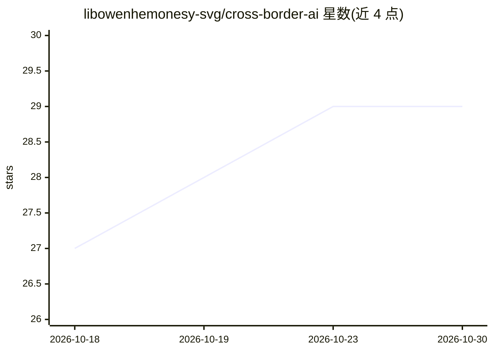

# libowenhemonesy-svg/cross-border-ai

⭐ 29 · Python · 推送 2026-09-20 · [GitHub](https://github.com/libowenhemonesy-svg/cross-border-ai) · 个人维护 · 中文 README

**跨境卖家的 AI 运营工作台：知识问答与笔记整理**

面向跨境电商运营者的 AI 工作台，当前实现知识问答与内容整理两条主线：基于 LangGraph 检索 Qdrant 向量库（BGE-M3）并调用模型生成带来源编号的回答，资料不足时明确告知；将运营笔记提炼为摘要、要点与标签，保存为 Obsidian 兼容的 Markdown 知识卡片。默认接入硅基流动接口，需自带模型凭证，通过 compose.langgraph.yml 部署。README 明确真实模型端到端验收未完成，历史文件存在疑似明文凭证，且仓库尚无统一许可证。

## 筛选速览

| 维度 | 判定 | 备注 |
|---|---|---|
| AI 角色 | `ai-native` | 本体是模型或模型工具 |
| 许可风险 | `none` | — |
| 部署形态 | `None` |  |
| 模型依赖 | — | README 未给出锁定关系 |
| 硬件要求 | — | 无带数字的原话,不猜 |
| 安装摩擦 | `low` | 无编译、无系统依赖或容器化 |
| 成熟度 | `idea` | |

## 能力要点

- LangGraph 单轮问答：检索、无资料分支、来源编号校验
- Markdown 长文分块（1500 字符上限、150 字符重叠）写入 Qdrant
- 内容整理生成摘要/要点/标签的 Obsidian 兼容知识卡片
- React Web 控制台支持网页触发索引、状态查询与失败重试

## 适用场景

- 把广告优化等运营笔记整理成知识卡片并建立可检索索引
- 向知识库提问并获得带来源引用、可回核的回答
- 跨境电商团队私有部署运营知识问答系统

## 场景标签

`文档问答` `知识库管理` · 领域:知识与检索

## 证据(README 行号)

> L7: 面向跨境运营的 AI 工作台，包含知识问答、内容整理与日报工作流。知识问答基于 LangGraph，从检索资料到生成回答，支持查看参考原文；资料不足时明确告知。
> L35: |LangGraph 问答|rag_graph.py|检索、无资料分支、真实模型回答、来源编号校验；单轮问答|
> L37: |AI 知识卡片|ai_processor.py|默认使用硅基流动接口；需要自己的有效模型凭证|

## 星数曲线

2026-10-18 27 → 2026-10-30 29（+2）

---
*卡片 v1 · prompt 1.4 · 生成 2026-10-26 · 置信度 high · 依据 README sha `242c4f7b7f8d` · [字段定义](../../DATASET.md)*
