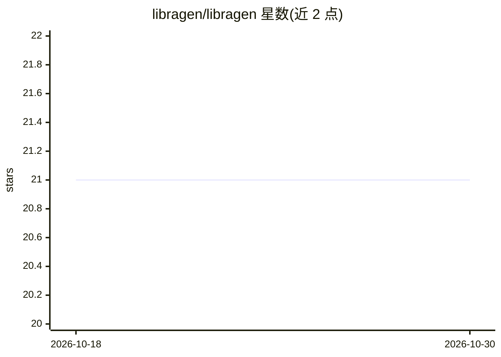

# libragen/libragen

⭐ 21 · TypeScript · MIT · 推送 2026-01-17 · [GitHub](https://github.com/libragen/libragen) · [官网](https://libragen.dev) · 组织维护

**为 AI 助手构建本地离线 RAG 文档库的 CLI 与 MCP 工具**

将本地目录或 git 仓库的文档构建为单一 .libragen（SQLite）文件，内含嵌入与向量检索能力，可分享给团队使用；全程本地运行，无需云服务或 API key。提供三个 npm 包：CLI 负责构建与查询，MCP Server 让 Claude Desktop、VS Code、Cursor 等 AI 工具检索库内容，core 提供编程 API。另支持 Obsidian 笔记库对话、CI 中自动构建等场景。MIT 许可。

## 筛选速览

| 维度 | 判定 | 备注 |
|---|---|---|
| AI 角色 | `ai-ecosystem` | LLM/agent 周边工具 |
| 许可风险 | `permissive` | MIT |
| 部署形态 | `library` | 以包/库形式分发 |
| 模型依赖 | — | README 未给出锁定关系 |
| 硬件要求 | — | 无带数字的原话,不猜 |
| 安装摩擦 | `low` | 无编译、无系统依赖或容器化 |
| 成熟度 | — | 结构信号不足 |

## 能力要点

- 从本地文档或 git 仓库构建单一 .libragen（SQLite）文件
- 通过 MCP 连接 Claude Desktop / VS Code / Cursor 等 AI 工具
- 完全本地运行，无云服务、无 API key
- 提供 GitHub Action 在 CI 中自动构建库文件

## 适用场景

- 让团队 AI 助手引用公司内部文档而非过时训练数据回答
- 与自己的 Obsidian 笔记库对话
- 把私有文档打包成单文件在团队内共享

## 场景标签

`RAG` · 领域:知识与检索

## 证据(README 行号)

> L21: Create private, local RAG libraries from any documentation. Libraries are single SQLite files you can share with yo
> L35: |`@libragen/mcp`|Connect AI assistants to your libraries via MCP|

## 星数曲线

2026-10-18 21 → 2026-10-30 21（+0）

---
*卡片 v1 · prompt 1.4 · 生成 2026-10-28 · 置信度 high · 依据 README sha `0ced03d747b1` · [字段定义](../../DATASET.md)*
