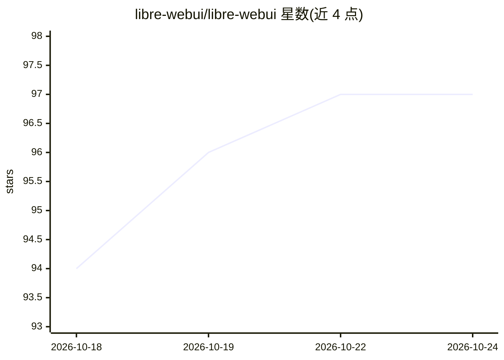

# libre-webui/libre-webui

⭐ 97 · TypeScript · Apache-2.0 · 推送 2026-10-21 · [GitHub](https://github.com/libre-webui/libre-webui) · [官网](https://librewebui.org) · 组织维护

**自托管本地优先 AI 工作台：聊天、知识检索、工件与隔离 agent 任务**

自托管的 AI 工作区应用，面向希望自行控制模型、数据与界面的用户：通过 Ollama 或云端模型进行对话，对 PDF/Office/Markdown 等文档做带引用的混合检索问答，生成交互式工件，并在含文件、终端、浏览器预览的隔离沙箱中运行模型驱动的任务（Work），含可观看的虚拟桌面与示范教学机制。支持 npm、Docker Compose、Kubernetes/Helm 及桌面客户端部署。本地推理无需云账号，不内置应用遥测。默认 Compose 配置挂载 Docker socket，对主机具有等同 root 的控制权限，需注意隔离限制。

## 筛选速览

| 维度 | 判定 | 备注 |
|---|---|---|
| AI 角色 | `ai-native` | 本体是模型或模型工具 |
| 许可风险 | `permissive` | Apache-2.0 |
| 部署形态 | `self-host` | docker 或自建部署 |
| 模型依赖 | local-ok | 支持本地模型 |
| 硬件要求 | — | 无带数字的原话,不猜 |
| 安装摩擦 | `low` | 无编译、无系统依赖或容器化 |
| 成熟度 | — | 结构信号不足 |

## 能力要点

- 本地优先：Ollama 默认路径，无需云账号或 API key
- Work 隔离任务沙箱：文件、终端、diff、预览与可观看的 agent 虚拟桌面
- 多 provider 插件层：聊天、图像、视频、嵌入、语音 provider 可扩展
- 文档混合检索带引用来源，及 OpenAI 兼容 /v1 公共 API

## 适用场景

- 在自己服务器上搭建带知识库检索的 AI 聊天工作台
- 让模型在隔离沙箱中执行编码/建站等 agent 任务并实时观看
- 多用户团队部署，按角色与共享授权管理 AI 使用

## 场景标签

`聊天机器人` `文档问答` · 领域:对话与助手

## 证据(README 行号)

> L35: Libre WebUI is a self-hosted AI workspace for people who want control over
> L38: Use local models through Ollama, connect the providers you
> L112: |**Chat**|Streaming conversations with prompt queueing, multi-model comparison, and chat forking|

## 星数曲线

2026-10-18 94 → 2026-10-24 97（+3）

---
*卡片 v1 · prompt 1.4 · 生成 2026-10-23 · 置信度 high · 依据 README sha `545b003f4e39` · [字段定义](../../DATASET.md)*
