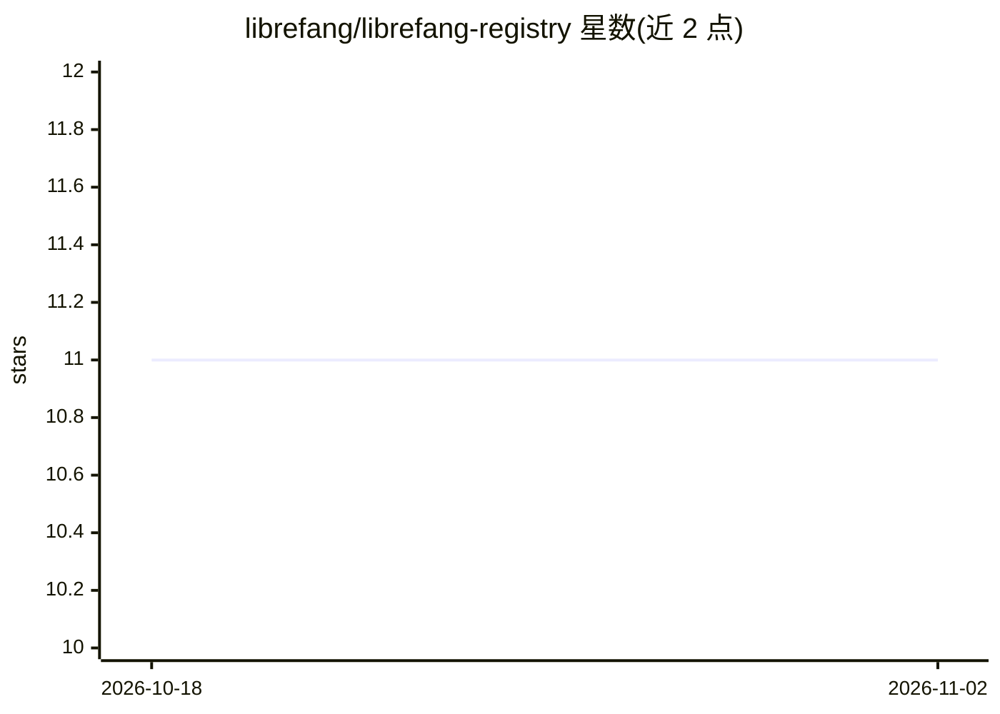

# librefang/librefang-registry

⭐ 11 · Python · MIT · 推送 2026-09-14 · [GitHub](https://github.com/librefang/librefang-registry) · 组织维护

**LibreFang Agent OS 的社区内容注册表：agents/hands/模型等 TOML 定义**

为开源 Agent 操作系统 LibreFang 维护的可安装内容定义仓库，通过 PR 提交而无需修改主程序。收录 14 个 Hands（含 agent+工具+面板的用户应用）、32 个内置 agent、25 个 MCP server 连接模板、49 个 provider 共 339 个模型定义（含定价/上下文/能力标记）、70 个模型别名、10 个插件、2 个技能与 9 个多 agent 工作流，均以 TOML 清单组织。提供 librefang catalog 命令安装、本地自定义路径与 python validate.py 校验脚本。限面向 LibreFang 生态使用。

## 筛选速览

| 维度 | 判定 | 备注 |
|---|---|---|
| AI 角色 | `ai-ecosystem` | LLM/agent 周边工具 |
| 许可风险 | `permissive` | MIT |
| 部署形态 | `None` |  |
| 模型依赖 | — | README 未给出锁定关系 |
| 硬件要求 | — | 无带数字的原话,不猜 |
| 安装摩擦 | `low` | 无编译、无系统依赖或容器化 |
| 成熟度 | — | 结构信号不足 |

## 能力要点

- TOML 清单定义 8 类内容：Hands/Agents/MCP Servers/Providers/Models/Aliases/Plugins/Skills/Workflows
- 49 个 provider 共 339 个模型定义，含定价、上下文窗口与能力标记
- 25 个 MCP server 连接模板，覆盖 devtools/data/productivity/cloud 等 6 类
- 提供 6 个起步模板与 validate.py 内容校验脚本

## 适用场景

- 为 LibreFang 安装或更新社区 agent、Hand 与 MCP 连接
- 查找 LLM provider 的模型元数据与定价信息
- 复制模板创建自定义 agent 或 Hand 并提交 PR

## 场景标签

`精选清单` · 领域:学习与行业

## 证据(README 行号)

> L3: Community-maintained content registry for LibreFang — the open-source Agent Operating System.
> L5: This repository is the **single source of truth** for all installable content definitions. Anyone can submit a PR to

## 星数曲线

2026-10-18 11 → 2026-11-02 11（+0）

---
*卡片 v1 · prompt 1.4 · 生成 2026-11-02 · 置信度 high · 依据 README sha `b1dbea582bc1` · [字段定义](../../DATASET.md)*
