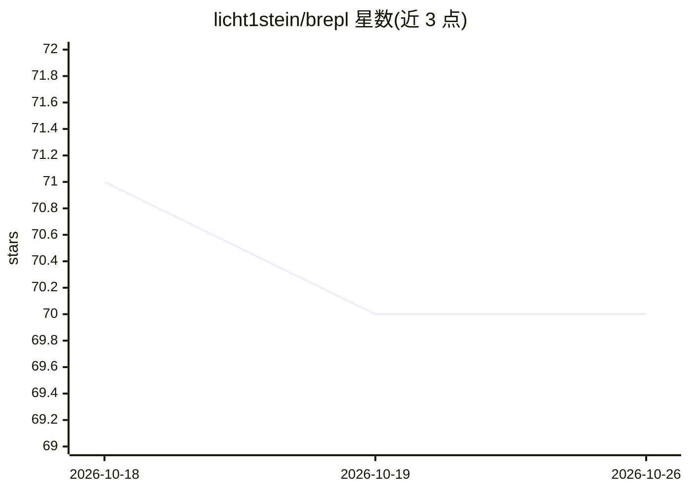

# licht1stein/brepl

⭐ 70 · Clojure · NOASSERTION · 推送 2026-02-17 · [GitHub](https://github.com/licht1stein/brepl) · 个人维护

**面向 AI 编码代理的括号修复型 Clojure nREPL 客户端**

基于 Babashka 运行时的 nREPL 客户端与 hook 工具，面向 Claude Code、ECA 等 AI 编码代理的 Clojure 开发流程。通过 hook 系统提供三项能力：基于 parmezan 的括号自动修复、REPL 求值（含 heredoc 模式规避 shell 引号问题）、编辑后文件的即时求值反馈。纯 Clojure 实现无外部二进制依赖，支持端口自动发现（.nrepl-port 文件、lsof 进程扫描）与远程连接，也可作为轻量 CLI 用于脚本与自动化。

## 筛选速览

| 维度 | 判定 | 备注 |
|---|---|---|
| AI 角色 | `ai-ecosystem` | LLM/agent 周边工具 |
| 许可风险 | `none` | NOASSERTION |
| 部署形态 | `None` |  |
| 模型依赖 | locked-api |  |
| 硬件要求 | — | 无带数字的原话,不猜 |
| 安装摩擦 | `low` | 无编译、无系统依赖或容器化 |
| 成熟度 | — | 结构信号不足 |

## 能力要点

- 基于 parmezan 的括号自动修复（写入文件前预校验）
- 通过 hooks 对接 Claude Code 与 ECA，一条命令完成安装
- 端口自动发现：.nrepl-port 查找与无状态进程扫描
- 支持原始 nREPL 消息（EDN 格式）访问全部协议操作

## 适用场景

- 让 Claude Code / ECA 写 Clojure 时自动修复括号并获得 REPL 反馈
- 命令行一次性求值或加载 Clojure 脚本
- 多项目/monorepo 环境下自动定位对应 nREPL 服务器

## 场景标签

 · 领域:开发工具/Clojure 生态

## 证据(README 行号)

> L10: **brepl** (Bracket-fixing REPL) enables AI-assisted Clojure development by solving the notorious parenthesis proble
> L16: **Primary use case:** Claude Code, ECA, and other AI coding agents that need reliable Clojure syntax handling and i

## 星数曲线

2026-10-18 71 → 2026-10-26 70（-1）

---
*卡片 v1 · prompt 1.4 · 生成 2026-10-24 · 置信度 high · 依据 README sha `2de3e1e9c5cf` · [字段定义](../../DATASET.md)*
