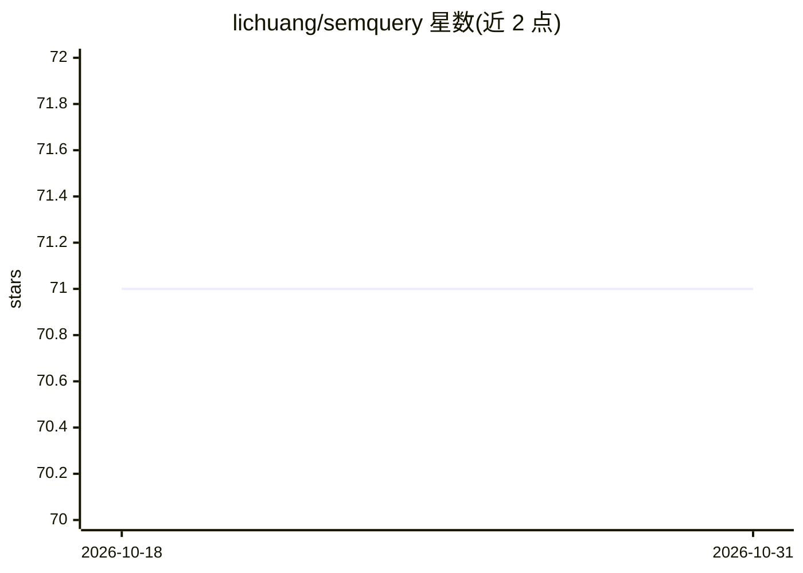

# lichuang/semquery

⭐ 71 · Rust · Apache-2.0 · 推送 2026-10-16 · [GitHub](https://github.com/lichuang/semquery) · 个人维护 · 中文 README

**本地离线文档搜索与问答 CLI：RAG 答案带引用**

Rust 编写的本地优先 RAG 工具：索引 Markdown/纯文本/PDF/Word 文档，支持 BM25 + 向量混合检索、RRF 融合与 cross-encoder 重排，全部数据存于单一 SQLite 文件（sqlite-vec + FTS5）。ask 命令通过 llama.cpp 运行本地 LLM 生成带 [N] 引用的回答，嵌入与重排使用 FastEmbed。面向个人用户在终端对本机文档做搜索与问答，中文场景使用 jieba 分词与句级切分。模型首次使用时自动下载，之后完全离线；自述处于早期开发阶段，CLI 在 1.0 前可能变更。

## 筛选速览

| 维度 | 判定 | 备注 |
|---|---|---|
| AI 角色 | `ai-native` | 本体是模型或模型工具 |
| 许可风险 | `permissive` | Apache-2.0 |
| 部署形态 | `library` | 以包/库形式分发 |
| 模型依赖 | — | README 未给出锁定关系 |
| 硬件要求 | — | 无带数字的原话,不猜 |
| 安装摩擦 | `medium` | 含编译或系统依赖之一 |
| 成熟度 | `idea` | |

## 能力要点

- BM25 + 向量召回 + RRF 融合 + cross-encoder 重排的混合检索
- 单一 SQLite 文件存储全部索引（sqlite-vec + FTS5）
- ask 返回带 [N] 内联引用的自然语言回答
- 中文优化：句级切分与 jieba 词级分词

## 适用场景

- 在终端对本机 Markdown/PDF/Word 文档做语义搜索
- 对个人文档库提问并获得带出处引用的回答
- 全程离线、数据不出本机的私有知识库问答

## 场景标签

`文档问答` `RAG` `语义搜索` · 领域:知识与检索

## 证据(README 行号)

> L8: `semquery` (short for **semantic query**) is a local, offline-ready RAG tool written in Rust. It indexes your person
> L12: - **Offline document search & Q&A engine** — Search passages or ask natural-language questions; everything runs loc
> L15: - **Cited answers** — `ask` returns natural-language answers with inline `[N]` citations pointing back to source fi

## 星数曲线

2026-10-18 71 → 2026-10-31 71（+0）

---
*卡片 v1 · prompt 1.4 · 生成 2026-10-24 · 置信度 high · 依据 README sha `a880f83648f0` · [字段定义](../../DATASET.md)*
