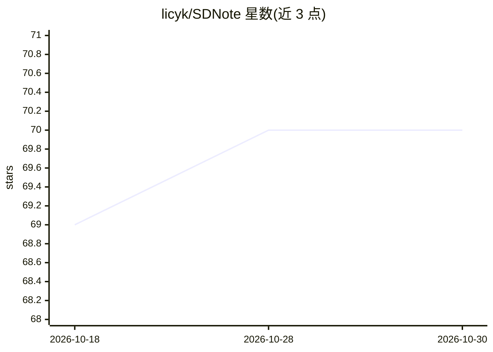

# licyk/SDNote

⭐ 70 · Python · GFDL-1.3 · 推送 2026-10-26 · [GitHub](https://github.com/licyk/SDNote) · [官网](https://sdnote.netlify.app) · 个人维护 · 中文 README

**AI 绘画（Stable Diffusion）中文使用文档与资源合集**

面向 AI 绘画用户的使用文档项目，内容为教程与相关资源聚合，主题围绕 Stable Diffusion。README 声明文档持续更新中且正在重构，主分支暂不更新但仍接受 PR；内容基于公开材料和经验编写，不对准确性负责。提供 GitHub Pages、Netlify、Vercel 与镜像站等多个在线阅读地址，可将仓库克隆到本地并运行 start.bat 构建文档。文档使用 GFDL 许可，引用需注明链接。

## 筛选速览

| 维度 | 判定 | 备注 |
|---|---|---|
| AI 角色 | `ai-knowledge` | 知识聚合/清单类 |
| 许可风险 | `viral` | GFDL-1.3 |
| 部署形态 | `None` |  |
| 模型依赖 | — | README 未给出锁定关系 |
| 硬件要求 | — | 无带数字的原话,不猜 |
| 安装摩擦 | `low` | 无编译、无系统依赖或容器化 |
| 成熟度 | — | 结构信号不足 |

## 能力要点

- AI 绘画教程与相关资源聚合文档
- 提供 4 个在线阅读地址（含国内镜像站）
- 支持克隆仓库到本地构建文档
- 接受 Issue 与 PR 社区贡献

## 适用场景

- 学习 Stable Diffusion 等 AI 绘画工具的使用方法
- 查找 AI 绘画相关的资源与教程
- 离线或本地构建阅读文档

## 场景标签

`教程课程` `精选清单` · 领域:学习与行业

## 证据(README 行号)

> L9: 一个关于使用 AI 绘画的文档，包含教程和相关资源。
> L13: 本文档持续更新中，欢迎您参与贡献本项目！

## 星数曲线

2026-10-18 69 → 2026-10-30 70（+1）

---
*卡片 v1 · prompt 1.4 · 生成 2026-10-24 · 置信度 high · 依据 README sha `e624071907b5` · [字段定义](../../DATASET.md)*
