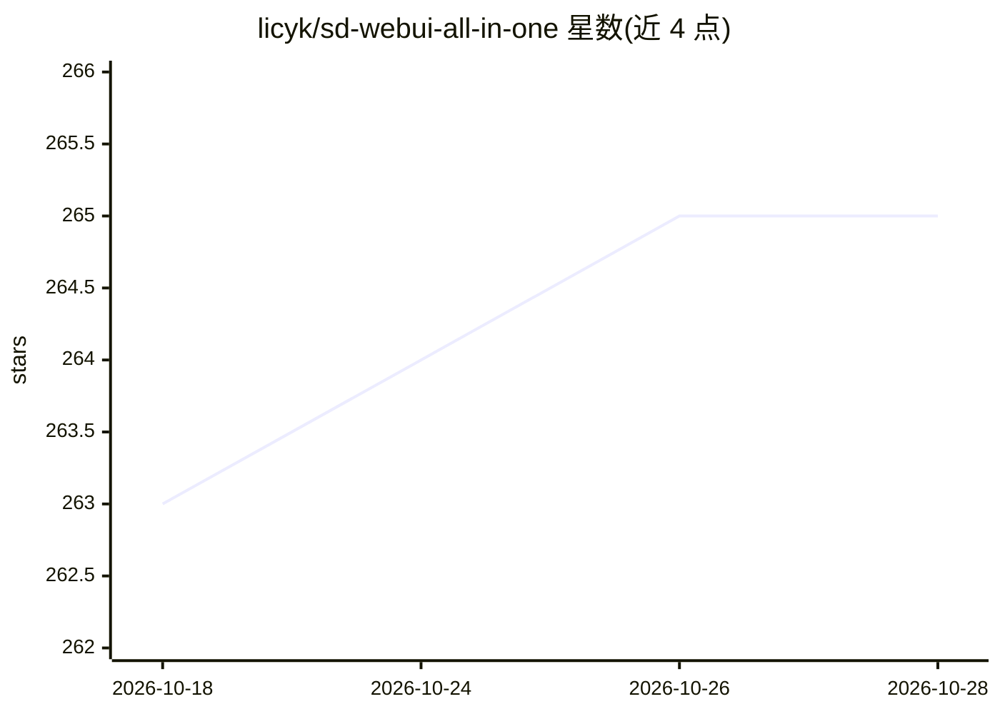

# licyk/sd-webui-all-in-one

⭐ 265 · Python · GPL-3.0 · 推送 2026-10-28 · [GitHub](https://github.com/licyk/sd-webui-all-in-one) · [官网](https://licyk.github.io/sd-webui-all-in-one) · 个人维护 · 中文 README

**多种 AI WebUI/训练工具的一体化安装、下载与管理方案**

面向 Stable Diffusion 生态用户，提供 Installer 安装脚本（Windows/Linux/macOS，不依赖系统 Git/Python，自建独立可迁移环境，可用作整合包制作器）、Windows 免安装整合包与下载器、Hanafubuki 图形管理界面、CLI/TUI、以及 Colab/Kaggle Jupyter Notebook 云端运行入口。覆盖 SD WebUI 各分支、ComfyUI、InvokeAI、Fooocus、Kohya GUI、sd-scripts 等约 23 种 WebUI 与训练工具，以及 Qwen TTS、RVC 等；可管理仓库、模型、扩展、PyTorch 重装与内网穿透。部分旧版 Notebook 已停止维护。

## 筛选速览

| 维度 | 判定 | 备注 |
|---|---|---|
| AI 角色 | `ai-ecosystem` | LLM/agent 周边工具 |
| 许可风险 | `viral` | GPL-3.0 |
| 部署形态 | `library` | 以包/库形式分发 |
| 模型依赖 | — | README 未给出锁定关系 |
| 硬件要求 | — | 无带数字的原话,不猜 |
| 安装摩擦 | `low` | 无编译、无系统依赖或容器化 |
| 成熟度 | — | 结构信号不足 |

## 能力要点

- Installer 在独立目录自建环境，不依赖系统 Git/Python，支持整合包全自动构建
- 覆盖 20 余种 WebUI / 训练工具的安装、启动与管理
- 提供 Colab / Kaggle Notebook 云端部署入口
- 多入口形态：安装脚本、整合包下载器、图形界面 Hanafubuki、CLI / TUI

## 适用场景

- 本地一键安装并管理 Stable Diffusion / ComfyUI 等 WebUI 与训练工具
- 下载 Windows 免安装整合包，开箱即用
- 在 Colab / Kaggle 云端运行 WebUI 或进行模型训练

## 场景标签

`图像生成` `模型训练` `语音合成` · 领域:内容生成

## 证据(README 行号)

> L40: SD WebUI All In One 提供本地安装、整合包下载、Hanafubuki 图形管理、Jupyter Notebook 云端运行和 CLI / TUI 管理等多种入口，用于快速安装、启动和维护常见 AI WebUI /
> L56: `sd-webui-all-in-one` 是用于多平台安装、启动和管理 WebUI / 训练工具的 CLI。它复用项目的 Python 管理核心，可用于管理仓库、模型、扩展、PyTorch、内网穿透和运行环境。支持部署的 Web
> L205: Installer 是适用于 Windows / Linux / macOS 的 WebUI / 训练工具安装与管理脚本。它不依赖系统中已有的 Git / Python，会在独立目录中准备运行环境，并生成启动、更新、终端、模型下

## 星数曲线

2026-10-18 263 → 2026-10-28 265（+2）

---
*卡片 v1 · prompt 1.4 · 生成 2026-10-22 · 置信度 high · 依据 README sha `d4138edcf4fe` · [字段定义](../../DATASET.md)*
