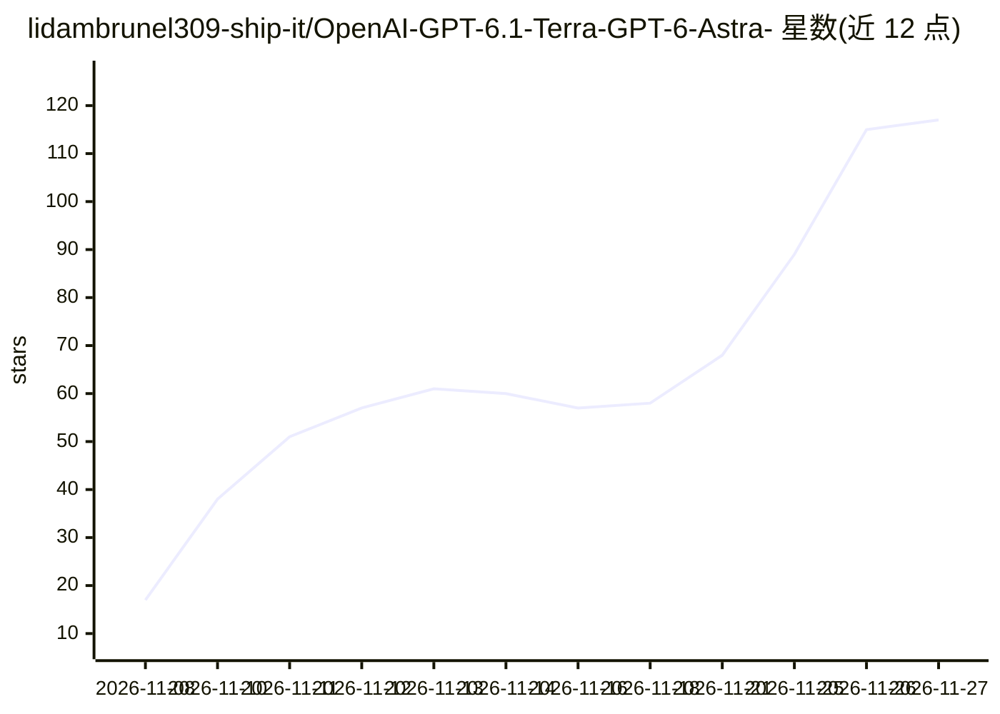

# lidambrunel309-ship-it/OpenAI-GPT-6.1-Terra-GPT-6-Astra-

⭐ 117 · 推送 2026-11-05 · [GitHub](https://github.com/lidambrunel309-ship-it/OpenAI-GPT-6.1-Terra-GPT-6-Astra-) · [官网](https://app.coregold.io/signup?invite_code=ADvlj9b) · 个人维护 · 中文 README

**推广 CoreGold 虚拟卡的 ChatGPT 订阅支付攻略（营销内容）**

仓库内容为一篇如何完成 ChatGPT Plus/Pro 订阅付费的攻略：解释 Stripe 风控拒卡原因，将国内双币卡、代充与 CoreGold 商业卡段做对照（后者标注高绑卡成功率、零封号），并给出 CoreGold 控制台充值 USDT、提取商业卡、绑卡支付的三步流程，末尾附入口链接与一串十六进制码。无代码、无安装与运行内容，性质为单一产品的导购式推广文案，主题标签中的 api 与正文无对应。

## 筛选速览

| 维度 | 判定 | 备注 |
|---|---|---|
| AI 角色 | `ai-knowledge` | 知识聚合/清单类 |
| 许可风险 | `none` | — |
| 部署形态 | `None` |  |
| 模型依赖 | — | README 未给出锁定关系 |
| 硬件要求 | — | 无带数字的原话,不猜 |
| 安装摩擦 | `low` | 无编译、无系统依赖或容器化 |
| 成熟度 | — | 结构信号不足 |

## 能力要点

- 解释 Stripe Radar 对亚太个人卡的拒卡机制
- 国内双币卡/代充与 CoreGold 商业卡段的对照表
- CoreGold 开卡-充值的分步操作流程

## 适用场景

- 了解跨境订阅 ChatGPT Plus/Pro 的支付渠道差异
- 按步骤开通 CoreGold 商业卡段用于订阅扣款

## 场景标签

 · 领域:跨境支付/营销内容

## 证据(README 行号)

> L5: OpenAI 正式发布 GPT-6.1 Terra 与面向自主智能体的 GPT-6 Astra 后，订阅 ChatGPT Plus（$20/月）与 Pro（$200/月）成为研发标配。
> L24: + CoreGold 商业卡段:

## 星数曲线

2026-11-08 17 → 2026-11-27 117（+100）

---
*卡片 v1 · prompt 1.4 · 生成 2026-11-18 · 置信度 low · 依据 README sha `fe81d8e8cf1a` · [字段定义](../../DATASET.md)*
