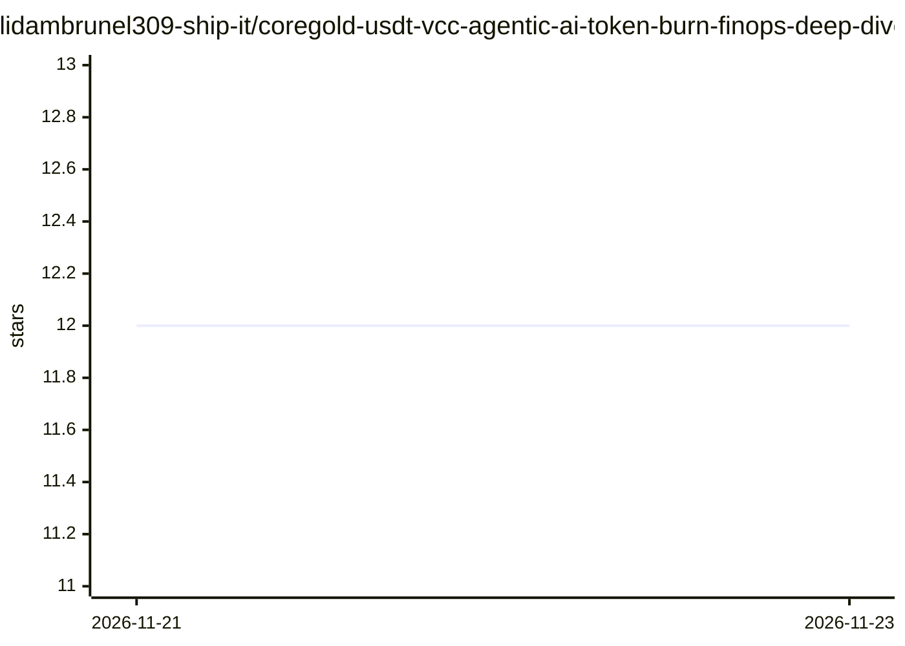

# lidambrunel309-ship-it/coregold-usdt-vcc-agentic-ai-token-burn-finops-deep-dive

⭐ 12 · 推送 2026-11-20 · [GitHub](https://github.com/lidambrunel309-ship-it/coregold-usdt-vcc-agentic-ai-token-burn-finops-deep-dive) · [官网](https://app.coregold.io/signup?invite_code=ADvlj9b) · 组织维护 · 中文 README

**讲解 AI Agent 高频扣款风险与 CoreGold 虚拟卡开卡实操**

一篇行业现状分析文章，围绕 2026 年 11 月企业与开发者部署 Agentic AI 后 Token 消耗上升、API 自动充值（Auto-Topup）高频扣款的场景，拆解收单网关风控的三个机制：发卡行 BIN 属性、AVS 地址校验、高频微额划扣的盗刷误判。提出"一服务一专卡+预算上限"的隔离策略，并给出 CoreGold 虚拟卡的注册、USDT（TRC20）充值、开卡、绑定 Apple Pay/Google Pay 的分步操作流程。内容以教程/实操指南形式呈现，面向遇到海外 AI 平台绑卡与扣款问题的开发者与团队。

## 筛选速览

| 维度 | 判定 | 备注 |
|---|---|---|
| AI 角色 | `ai-knowledge` | 知识聚合/清单类 |
| 许可风险 | `none` | — |
| 部署形态 | `None` |  |
| 模型依赖 | — | README 未给出锁定关系 |
| 硬件要求 | — | 无带数字的原话,不猜 |
| 安装摩擦 | `low` | 无编译、无系统依赖或容器化 |
| 成熟度 | — | 结构信号不足 |

## 能力要点

- 拆解 Stripe Radar 风控的 BIN 属性、AVS 校验、高频扣款误判三个机制
- 提出一卡一用途的预算隔离与卡片余额硬上限策略
- 说明数字钱包 DPAN 动态令牌的支付流程
- 给出 USDT（TRC20）充值到开卡绑卡的分步操作

## 适用场景

- 为海外 AI API 平台准备可控制预算的支付卡
- 排查绑卡被风控拒绝或自动充值锁卡的原因
- 按项目隔离不同 AI 服务的扣款资金

## 场景标签

`教程课程` · 领域:学习与行业

## 证据(README 行号)

> L3: # ⚡ AI Agent 吞 Token 时代：从清算底层拆解如何防锁卡、防账单穿透（附 CoreGold 实操）
> L35: ### 🧭 极简开卡与绑定流程（一看就会）

## 星数曲线

2026-11-21 12 → 2026-11-23 12（+0）

---
*卡片 v1 · prompt 1.4 · 生成 2026-11-21 · 置信度 mid · 依据 README sha `1d9fdcfc0f53` · [字段定义](../../DATASET.md)*
