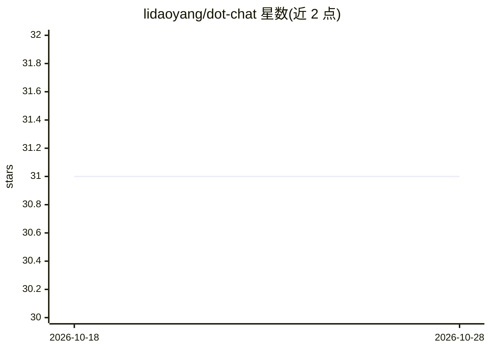

# lidaoyang/dot-chat

⭐ 31 · Java · MulanPSL-2.0 · 推送 2026-07-29 · [GitHub](https://github.com/lidaoyang/dot-chat) · 个人维护 · 中文 README

**Web 版仿微信聊天软件，接入 DeepSeek AI 智能回复**

基于 SpringBoot 3.3 + JDK17 + tio WebSocket 框架开发的前后端分离 Web 聊天软件，含核心服务、管理后台、纯静态前端三个模块，支持手机端和 PC 端浏览器访问。功能覆盖即时通讯（文字/图片/文件）、语音视频通话、群聊、用户管理，业务数据用 MySQL 8.0，缓存与会话用 Redis，通过 Nginx 反代部署。集成 DeepSeek-V3 大模型提供 AI 智能回复（流式响应），根据好友消息自动生成回复内容。

## 筛选速览

| 维度 | 判定 | 备注 |
|---|---|---|
| AI 角色 | `ai-enhanced` | 去掉 AI 部分产品仍成立 |
| 许可风险 | `viral` | MulanPSL-2.0 |
| 部署形态 | `None` |  |
| 模型依赖 | locked-api |  |
| 硬件要求 | — | 无带数字的原话,不猜 |
| 安装摩擦 | `medium` | 含编译或系统依赖之一 |
| 成熟度 | — | 结构信号不足 |

## 能力要点

- 跨平台 Web 即时通讯，支持手机端与 PC 端
- 基于 tio 的 WebSocket 长连接，支撑单聊/群聊/语音视频信令
- 集成 DeepSeek-V3 的 AI 智能回复，支持流式响应
- 附带管理后台：用户/消息管理与数据统计

## 适用场景

- 搭建自己的 Web 聊天/即时通讯服务
- 在聊天中用 AI 自动生成回复内容
- 通过管理后台管理用户与消息数据

## 场景标签

`聊天机器人` · 领域:对话与助手

## 证据(README 行号)

> L6: 已接入 **DeepSeek-V3** AI智能回复功能，如果不知道怎么回复，可以使用"**AI智能回复**"来帮你回复。
> L39: - **`dot-chat-server`**：核心服务模块，提供 REST API 接口和 WebSocket 长连接服务。基于 **tio** 框架实现 WebSocket 通信，支撑即时消息推送、单聊、群聊、语音视频信令等实

## 星数曲线

2026-10-18 31 → 2026-10-28 31（+0）

---
*卡片 v1 · prompt 1.4 · 生成 2026-10-26 · 置信度 high · 依据 README sha `a3f462aab5b6` · [字段定义](../../DATASET.md)*
