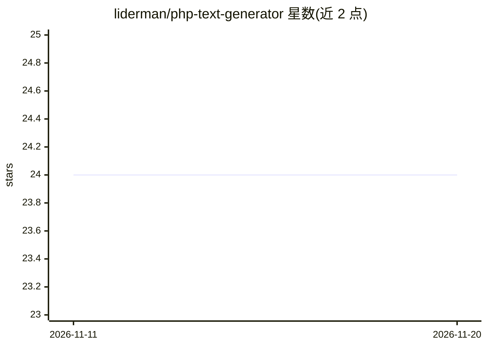

# liderman/php-text-generator

⭐ 24 · PHP · MIT · 推送 2026-11-10 · [GitHub](https://github.com/liderman/php-text-generator) · 个人维护

**PHP 按模板掩码生成 SEO 文本的库**

PHP 编写的文本生成库：按掩码模板在花括号选项中随机取值生成文本，支持递归嵌套模板规则与多编码，实现过程不使用正则表达式。无外部依赖，要求 PHP >= 7.1，通过 composer 安装。功能与 Go 语言的 text-generator 包对应，含测试与 PHP-Doc 文档，面向需要在 PHP 项目中批量生成模板化文本的开发者。

## 筛选速览

| 维度 | 判定 | 备注 |
|---|---|---|
| AI 角色 | `ai-ecosystem` | LLM/agent 周边工具 |
| 许可风险 | `permissive` | MIT |
| 部署形态 | `None` |  |
| 模型依赖 | — | README 未给出锁定关系 |
| 硬件要求 | — | 无带数字的原话,不猜 |
| 安装摩擦 | `low` | 无编译、无系统依赖或容器化 |
| 成熟度 | — | 结构信号不足 |

## 能力要点

- 按掩码模板随机生成文本，支持递归嵌套规则
- 不使用正则表达式的实现
- 无外部依赖，支持多编码
- 静态分析 PhpStan lvl 7 检查，含测试与 PHP-Doc 文档

## 适用场景

- 在 PHP 项目中按模板批量生成 SEO 文本
- 生成带随机变体的嵌套模板文本

## 场景标签

 · 领域:文本生成/SEO 工具

## 证据(README 行号)

> L2: Fast SEO text generator on a mask.
> L24: echo $textGen->generate("Good {morning|day}!");

## 星数曲线

2026-11-11 24 → 2026-11-20 24（+0）

---
*卡片 v1 · prompt 1.4 · 生成 2026-11-18 · 置信度 high · 依据 README sha `190e98ab94d5` · [字段定义](../../DATASET.md)*
