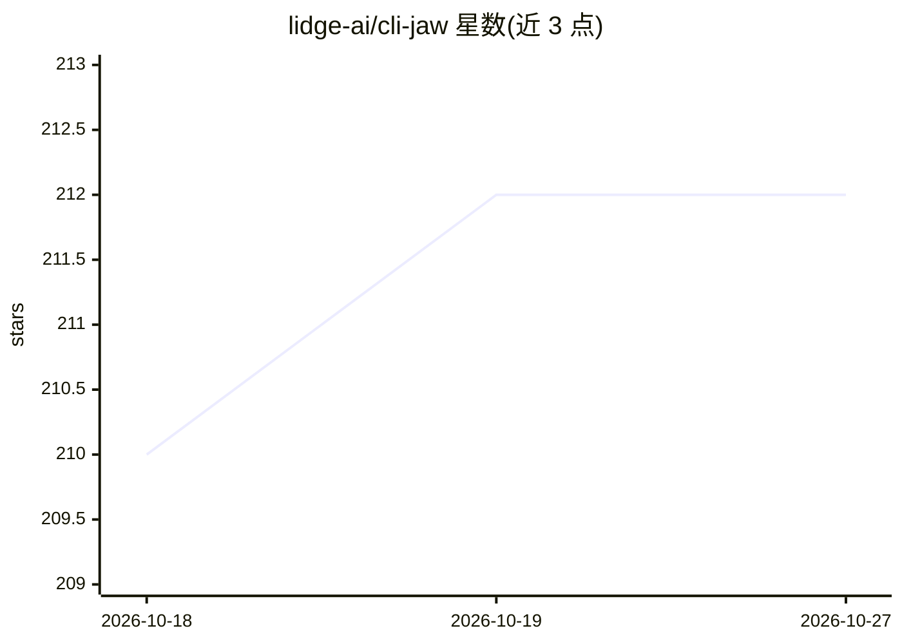

# lidge-ai/cli-jaw

⭐ 212 · TypeScript · MIT · 推送 2026-10-10 · [GitHub](https://github.com/lidge-ai/cli-jaw) · [官网](https://lidge-ai.github.io/cli-jaw/) · 组织维护

**统一管理多个 AI 编程 CLI 的个人编排器与仪表盘**

CLI-JAW 将用户已有的 AI 编程 CLI（Claude、Codex、Cursor、Grok、Copilot、OpenCode、Kiro、Antigravity、Pi）统一为一个助手：主 CLI（Boss）可调用其他 CLI 作为 employees，共享一份记忆，并提供管理仪表盘、Kanban 看板、Markdown 笔记工作区。无需 API key，复用既有订阅，本地运行。原生 Code API 提供隔离的多 runtime 会话与断点续传。支持 npm、桌面安装包、一键脚本与 Docker 部署；Windows 原生 PowerShell 安装器为 beta。注意 Claude E 与 ai-e 多路复用器已移除。

## 筛选速览

| 维度 | 判定 | 备注 |
|---|---|---|
| AI 角色 | `ai-ecosystem` | LLM/agent 周边工具 |
| 许可风险 | `permissive` | MIT |
| 部署形态 | `desktop` | 安装包/桌面程序 |
| 模型依赖 | locked-api |  |
| 硬件要求 | — | 无带数字的原话,不猜 |
| 安装摩擦 | `low` | 无编译、无系统依赖或容器化 |
| 成熟度 | `idea` | |

## 能力要点

- 一个主 CLI 调度多个 AI CLI 协同工作（Boss/employees 模式）
- 无需 API key，路由至既有订阅，本地运行
- 管理仪表盘（端口 24576）+ 各实例 Web UI（端口 3457）
- 提供 npm / 桌面安装包 / 一键脚本 / Docker compose 多种安装方式

## 适用场景

- 同时使用多个 AI 编程 CLI 时避免来回切换与复制粘贴
- 通过统一仪表盘启动、停止和监控各 AI 会话实例
- 用看板和优先级矩阵跟踪多个 agent 会话的工作进度

## 场景标签

`多智能体` `AI 助手` · 领域:Agent 开发

## 证据(README 行号)

> L3:  One assistant, one memory, one dashboard for the AI coding CLIs you already pay for.
> L43: CLI-JAW unifies the AI coding CLIs you already use into **one assistant with one memory and one dashboard**. Your m

## 星数曲线

2026-10-18 210 → 2026-10-27 212（+2）

---
*卡片 v1 · prompt 1.4 · 生成 2026-10-22 · 置信度 high · 依据 README sha `7c61a0c2f52f` · [字段定义](../../DATASET.md)*
