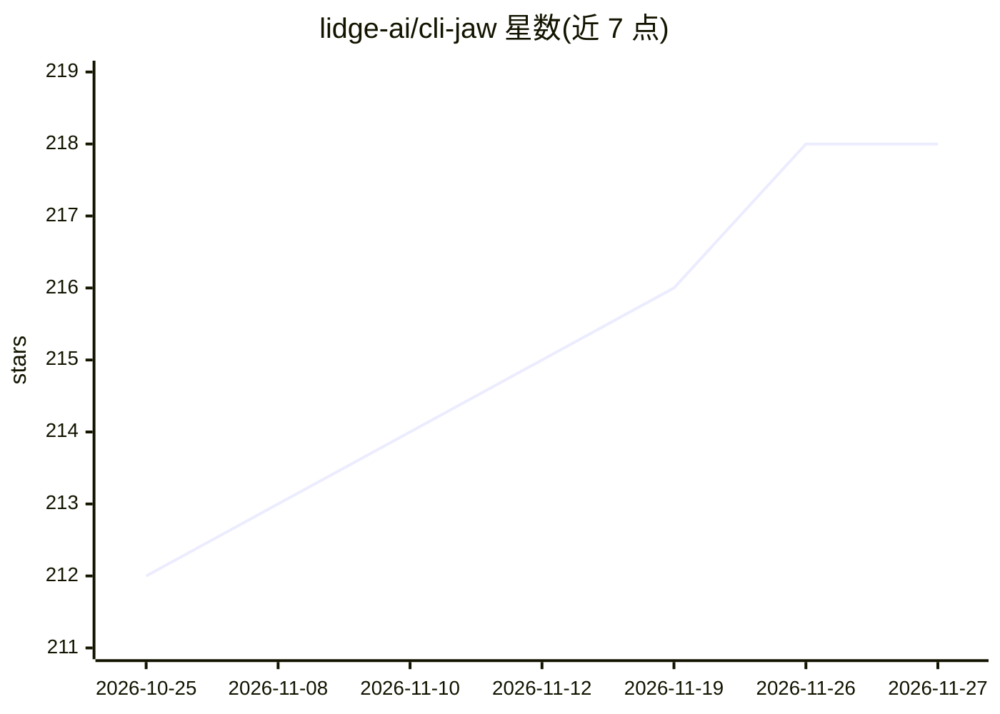

# lidge-ai/cli-jaw

⭐ 218 · TypeScript · MIT · 推送 2026-11-11 · [GitHub](https://github.com/lidge-ai/cli-jaw) · [官网](https://lidge-ai.github.io/cli-jaw/) · 组织维护 · 中文 README

**把多个 AI 编码 CLI 统一到一个助手与仪表盘的管理工具**

CLI-JAW 通过 npm 或安装包运行，将 Claude、Codex、Cursor、Grok、Copilot、OpenCode 等已有 AI 编码 CLI 集成到一个带共享记忆的助手与仪表盘中；主 CLI 作为 Boss 调度其他 CLI 作为员工执行任务并复核输出。提供 Kanban 面板、优先级矩阵、Markdown 工作区、Web/桌面/Telegram/Discord/Slack 访问入口。需要 Node.js 22.4+，Windows 推荐经 WSL 运行，本机 PowerShell 安装为 beta；路由走既有订阅，无 API key。

## 筛选速览

| 维度 | 判定 | 备注 |
|---|---|---|
| AI 角色 | `ai-ecosystem` | LLM/agent 周边工具 |
| 许可风险 | `permissive` | MIT |
| 部署形态 | `desktop` | 安装包/桌面程序 |
| 模型依赖 | — | README 未给出锁定关系 |
| 硬件要求 | — | 无带数字的原话,不猜 |
| 安装摩擦 | `low` | 无编译、无系统依赖或容器化 |
| 成熟度 | — | 结构信号不足 |

## 能力要点

- 统一仪表盘管理多个 AI 编码 CLI 实例的启停与预览
- Boss/employees 机制：主 CLI 调度其他 CLI 并复核输出
- 无需 API key，经由既有订阅路由，本地运行
- 提供 macOS .dmg、Windows .exe、Linux .AppImage 安装包

## 适用场景

- 在同一仪表盘中同时管理 Claude Code、Codex 等多个 CLI 会话
- 让一个主 Agent 把任务分派给多个 CLI Agent 并汇总结果
- 通过 Web 或 Telegram/Discord/Slack 远程访问本地 Agent

## 场景标签

`多智能体` `编码 Agent` `AI 助手` · 领域:Agent 开发

## 证据(README 行号)

> L43: CLI-JAW unifies the AI coding CLIs you already use into **one assistant with one memory and one dashboard**. Your m
> L45: - **No API keys needed** — routes through subscriptions you already pay for
> L50: The native Code API (`/api/code`) provides isolated Codex, Claude, Cursor, and Grok sessions with durable transcrip

## 星数曲线

2026-10-25 212 → 2026-11-27 218（+6）

---
*卡片 v1 · prompt 1.4 · 生成 2026-11-25 · 置信度 high · 依据 README sha `d1ce2c56de64` · [字段定义](../../DATASET.md)*
