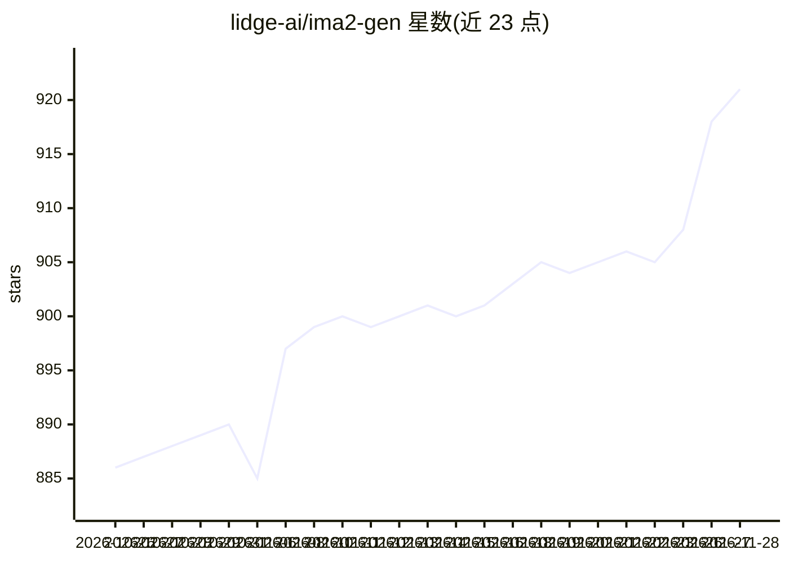

# lidge-ai/ima2-gen

⭐ 921 · TypeScript · MIT · 推送 2026-11-27 · [GitHub](https://github.com/lidge-ai/ima2-gen) · [官网](https://lidge-ai.github.io/ima2-gen/) · 个人维护

**本地运行的图像视频生成工作室，人和编码代理都能用**

在本地机器上运行一个小型服务器，保存所有生成结果到 ~/.ima2/generated，通过浏览器、Mac 应用、CLI 或编码代理使用。生成时每个结果保留提示词、耗时与设置；节点图支持从一个图像分支出多个方向且记录父子关系；Canvas Mode 提供标注、擦除、抠背景与带 alpha 导出。视频生成需 Grok OAuth 登录；CLI 在未配置默认模型时以 NO_DEFAULT_MODEL 报错，升级不会静默切换计费通道。

## 筛选速览

| 维度 | 判定 | 备注 |
|---|---|---|
| AI 角色 | `ai-native` | 本体是模型或模型工具 |
| 许可风险 | `permissive` | MIT |
| 部署形态 | `desktop` | 安装包/桌面程序 |
| 模型依赖 | locked-api |  |
| 硬件要求 | — | 无带数字的原话,不猜 |
| 安装摩擦 | `low` | 无编译、无系统依赖或容器化 |
| 成熟度 | — | 结构信号不足 |

## 能力要点

- 多通道接入 OpenAI OAuth/API、Grok、Gemini、NovelAI、ComfyUI 等 11 条 lane
- 节点图分支保留父子关系，结果按请求 ID 回配恢复
- Canvas Mode 支持导出真 alpha、SVG 嵌入栅格与矢量描摹
- 自带三个 Markdown agent skill，供编码代理加载结构化图像/视频工作流

## 适用场景

- 在本地生成和整理图像/视频并保留完整参数历史
- 让编码代理通过 CLI 或 skill 文件调用生成流程
- 用节点图把一张好图分支成多个风格变体
- 通过 Grok 视频模型做文生视频与故事板连续帧

## 场景标签

`图像生成` `视频生成` `图像视频处理` · 领域:内容生成

## 证据(README 行号)

> L47: `ima2-gen` is a local-first visual generation runtime and studio for people and coding agents, with reproducible im
> L5: Use it from the browser, the Mac app, the CLI, or hand it to your coding agent.
> L164: ima2-gen ships three Markdown skills that coding agents load for structured image, video, frontend-asset and desig

## 星数曲线

2026-10-26 886 → 2026-11-28 921（+35）

---
*卡片 v1 · prompt 1.4 · 生成 2026-11-28 · 置信度 high · 依据 README sha `a70eb01edeb3` · [字段定义](../../DATASET.md)*
