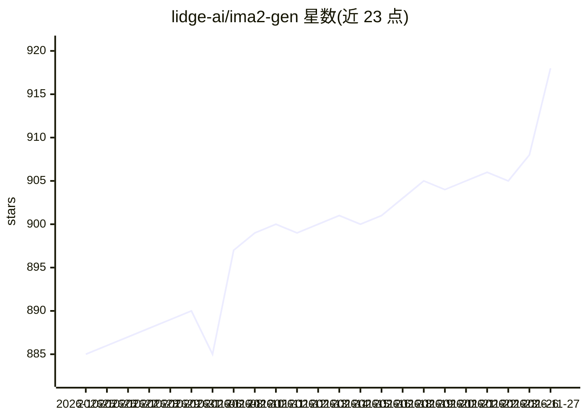

# lidge-ai/ima2-gen

⭐ 918 · TypeScript · MIT · 推送 2026-11-26 · [GitHub](https://github.com/lidge-ai/ima2-gen) · [官网](https://lidge-ai.github.io/ima2-gen/) · 组织维护 · 中文 README

**本地图像视频生成工作室：供人和编码 agent 调用多提供商**

在本机运行小型服务器与工作室的视觉生成运行时：写提示词、挂参考图、在节点图中分支变体、在 Canvas 模式擦除抠图并导出带 alpha 的结果，图与视频及元数据保留在 ~/.ima2/generated。接入 OpenAI OAuth/API、Grok OAuth/API、Gemini API、NovelAI、ComfyUI 等多条 lane，视频生成需 Grok 登录。提供 Mac 桌面应用、npm 包、一键安装脚本、Docker 与 CLI，并向编码 agent 输出三个 Markdown skill。

## 筛选速览

| 维度 | 判定 | 备注 |
|---|---|---|
| AI 角色 | `ai-native` | 本体是模型或模型工具 |
| 许可风险 | `permissive` | MIT |
| 部署形态 | `desktop` | 安装包/桌面程序 |
| 模型依赖 | locked-api |  |
| 硬件要求 | — | 无带数字的原话,不猜 |
| 安装摩擦 | `low` | 无编译、无系统依赖或容器化 |
| 成熟度 | — | 结构信号不足 |

## 能力要点

- 多 lane 提供商路由：oauth/api/grok/gemini/nai/comfy 等，每任务指定提供商
- 节点图分支保留父子关系，Canvas 导出支持真 alpha 与矢量描摹
- 面向编码 agent 的三个 Markdown skill（core/front/uiux）
- 分发覆盖 Mac dmg、npm、Windows/Linux 一键安装脚本与 Docker

## 适用场景

- 在本机批量生成与分支迭代图像、视频素材
- 让编码 agent 通过 CLI 与 skill 调用图像视频生成流程
- 为前端/UI 设计工作流生成素材并导出 SVG

## 场景标签

`图像生成` `视频生成` · 领域:内容生成

## 证据(README 行号)

> L47: `ima2-gen` is a local-first visual generation runtime and studio for people and coding agents, with reproducible im
> L148: - **Create**: generate, edit, reuse the current image, paste references, and continue from history. Attach up to 5

## 星数曲线

2026-10-25 885 → 2026-11-27 918（+33）

---
*卡片 v1 · prompt 1.4 · 生成 2026-11-27 · 置信度 high · 依据 README sha `73ee6e5a8de0` · [字段定义](../../DATASET.md)*
