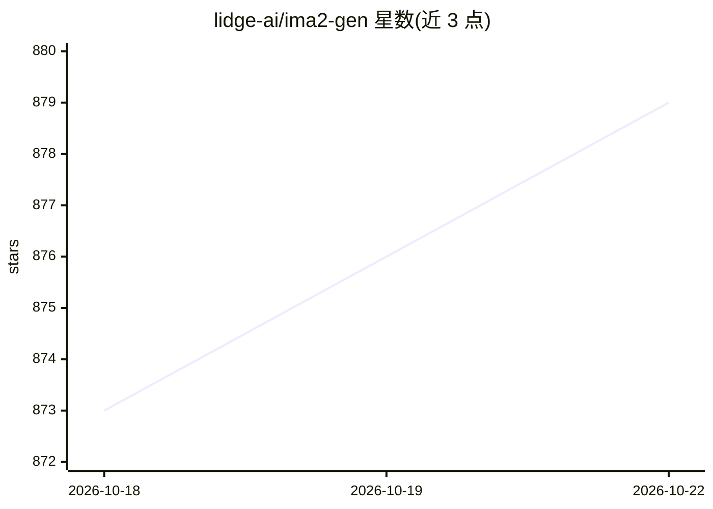

# lidge-ai/ima2-gen

⭐ 881 · TypeScript · MIT · 推送 2026-10-22 · [GitHub](https://github.com/lidge-ai/ima2-gen) · [官网](https://lidge-ai.github.io/ima2-gen/) · 组织维护

**本地优先的图像/视频生成工作室，供人与编码 agent 使用**

ima2-gen 是运行在本机的视觉生成运行时与工作室：本地起小型服务器，生成结果存于 ~/.ima2/generated，通过浏览器、Mac 应用、CLI 或编码 agent 使用。支持 OpenAI OAuth/API、Grok OAuth/API、Gemini API、Antigravity CLI、AtlasCloud、MiniMax、NovelAI 及已注册的 ComfyUI 工作流，Runway 与 Higgsfield 为 MCP 集成。提供节点图分支、Canvas 抠图、视频生成、栅格转矢量、提示词库等功能，并附带三份供 agent 加载的 Markdown 技能文档。

## 筛选速览

| 维度 | 判定 | 备注 |
|---|---|---|
| AI 角色 | `ai-native` | 本体是模型或模型工具 |
| 许可风险 | `permissive` | MIT |
| 部署形态 | `desktop` | 安装包/桌面程序 |
| 模型依赖 | locked-api |  |
| 硬件要求 | — | 无带数字的原话,不猜 |
| 安装摩擦 | `low` | 无编译、无系统依赖或容器化 |
| 成熟度 | — | 结构信号不足 |

## 能力要点

- 本地服务器 + 浏览器/Mac 应用/CLI 多入口，产出存本地
- 十多条 provider 通道（OAuth 与 API key 双路）
- 节点图分支与 Canvas 模式（抠图、alpha 导出）
- 三份面向编码 agent 的技能文档（Core/Frontend/UI-UX）

## 适用场景

- 在本机统一调用 GPT/Grok/Gemini 等多个模型生成图与视频
- 用节点图把一张图分支成多方向变体
- 让编码 agent 通过 CLI 与技能文档执行前端资产生产流程
- 生成视频并用分镜模式保持角色与场景一致

## 场景标签

`图像生成` `视频生成` · 领域:内容生成

## 证据(README 行号)

> L47: `ima2-gen` is a local-first visual generation runtime and studio for people and coding agents, with reproducible im
> L3:  Generate, branch and clean up images and video on your own machine.
> L162: ima2-gen ships three Markdown skills that coding agents load for structured image, video, frontend-asset and desig

## 星数曲线

2026-10-18 873 → 2026-10-22 879（+6）

---
*卡片 v1 · prompt 1.4 · 生成 2026-10-21 · 置信度 high · 依据 README sha `52d6d77f02e7` · [字段定义](../../DATASET.md)*
