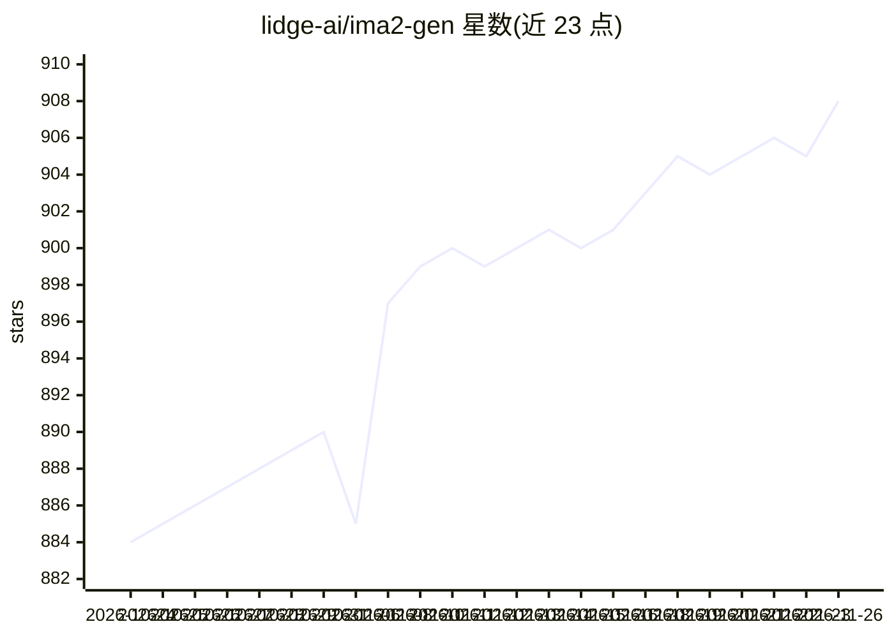

# lidge-ai/ima2-gen

⭐ 908 · TypeScript · MIT · 推送 2026-11-23 · [GitHub](https://github.com/lidge-ai/ima2-gen) · [官网](https://lidge-ai.github.io/ima2-gen/) · 组织维护 · 中文 README

**本地优先的图像/视频生成运行时与工作台，供人和编码 agent 使用**

在用户本机运行小型服务器的视觉生成运行时与工作台：生成、分叉、清理图像与视频，图像存于本地目录，每次生成保留提示词、参数与元数据。通过 CLI、浏览器、Mac 应用使用，也可由编码 agent 调用。接入 OpenAI（OAuth/API）、Grok、Gemini、NovelAI、ComfyUI 等多条通道，Runway/Higgsfield 为独立 MCP 集成。未配置默认模型时 CLI 按失败关闭策略报错，不会静默切换通道或计费通道。提供 npm、Mac DMG、Windows/Linux 一键安装脚本与 Docker 方式。

## 筛选速览

| 维度 | 判定 | 备注 |
|---|---|---|
| AI 角色 | `ai-native` | 本体是模型或模型工具 |
| 许可风险 | `permissive` | MIT |
| 部署形态 | `desktop` | 安装包/桌面程序 |
| 模型依赖 | locked-api |  |
| 硬件要求 | — | 无带数字的原话,不猜 |
| 安装摩擦 | `low` | 无编译、无系统依赖或容器化 |
| 成熟度 | — | 结构信号不足 |

## 能力要点

- 节点图分支：每个分支记录父节点，历史不被覆盖
- Canvas 模式：标注、擦除、抠背景、带 alpha 导出与栅格转矢量
- 本产品附带三份供编码 agent 加载的 Markdown 技能文件（core/front/uiux）
- 多通道接入：OpenAI OAuth/API、Grok、Gemini、NovelAI、ComfyUI、MiniMax、AtlasCloud 等

## 适用场景

- 在本机批量生成与分支迭代图像、视频素材
- 让编码 agent 通过 CLI 与技能文件调用图像/视频生成
- 在画布上清理背景并导出透明或矢量格式的前端素材

## 场景标签

`图像生成` `视频生成` `图像视频处理` · 领域:内容生成

## 证据(README 行号)

> L47: `ima2-gen` is a local-first visual generation runtime and studio for people and coding agents, with reproducible im
> L181: |Lane|Auth|Images|Video|Notes|
> L164: ima2-gen ships three Markdown skills that coding agents load for structured image, video, frontend-asset and desig

## 星数曲线

2026-10-24 884 → 2026-11-26 908（+24）

---
*卡片 v1 · prompt 1.4 · 生成 2026-11-25 · 置信度 high · 依据 README sha `2a365eadae53` · [字段定义](../../DATASET.md)*
