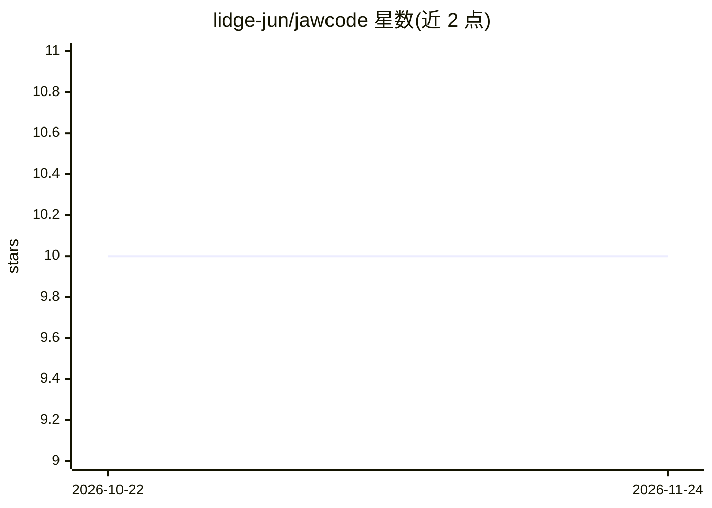

# lidge-jun/jawcode

⭐ 10 · TypeScript · MIT · 推送 2026-10-16 · [GitHub](https://github.com/lidge-jun/jawcode) · [官网](https://lidge-jun.github.io/jawcode/) · 个人维护

**面向开发者的 coding-agent 运行器：结构化 IPABCD 工作流**

Jawcode（jwc）是一个独立的 coding-agent harness，以 Bun 为运行时，从任意仓库或 worktree 启动，为 agent 提供六阶段 IPABCD 工作流（Interview/Plan/Audit/Build/Check/Done），各阶段设显式门禁，未通过对抗性审查不能报告完成。支持 HITL（人工逐阶段审批）与 HOTL（目标驱动自主推进）两种控制模式，内置五个角色子代理并行执行、40+ 工具（代码搜索、AST 编辑、浏览器控制、调试器等）。声明为实验性 beta 项目。

## 筛选速览

| 维度 | 判定 | 备注 |
|---|---|---|
| AI 角色 | `ai-ecosystem` | LLM/agent 周边工具 |
| 许可风险 | `permissive` | MIT |
| 部署形态 | `library` | 以包/库形式分发 |
| 模型依赖 | local-ok | 支持本地模型 |
| 硬件要求 | — | 无带数字的原话,不猜 |
| 安装摩擦 | `low` | 无编译、无系统依赖或容器化 |
| 成熟度 | `idea` | |

## 能力要点

- 46 providers、3,600+ 模型接入，会话中可切换模型
- IPABCD 六阶段工作流，带阶段门禁与对抗性审查
- 五个角色子代理异步并行，含 correction de-anchoring 机制
- 40+ 内置工具：AST 搜索/编辑、浏览器控制、DAP 调试、tmux worker 协调

## 适用场景

- 在仓库中按结构化流程完成从需求澄清到交付的编码任务
- 以 HITL 模式逐阶段审批 agent 的计划与产出
- 并行调度多个子代理执行实现、审查、规划分工

## 场景标签

`编码 Agent` · 领域:编码与开发

## 证据(README 行号)

> L19: Jawcode (`jwc`) is a standalone coding-agent harness. 46 providers, 3,600+ models, Bun-native. It runs from any rep
> L118: - **46 providers, 3,600+ models**: Anthropic, OpenAI, Google, xAI, Groq, DeepSeek, Mistral, Amazon Bedrock, Google

## 星数曲线

2026-10-22 10 → 2026-11-24 10（+0）

---
*卡片 v1 · prompt 1.4 · 生成 2026-11-19 · 置信度 high · 依据 README sha `ed4aeeebe71e` · [字段定义](../../DATASET.md)*
