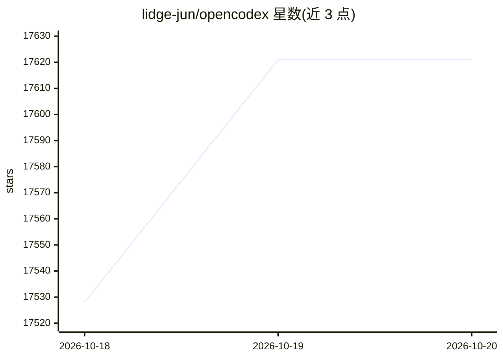

# lidge-jun/opencodex

⭐ 17,621 · TypeScript · MIT · 推送 2026-10-19 · [GitHub](https://github.com/lidge-jun/opencodex) · [官网](https://opencodex.me/) · 个人维护

**本地代理：让 Codex/Claude Code 等前端接入任意 LLM 提供商**

运行在本地的轻量代理与仪表盘，将 OpenAI Codex 的 Responses API 协议翻译为各提供商接口（支持流式、工具调用、推理 token、图像双向转换），使 Codex CLI/App/SDK、Claude Code、Claude Desktop、Grok Build 可使用 Claude、Gemini、Grok、DeepSeek、Ollama 等 40+ 内置提供商或任意 OpenAI 兼容端点。附加功能包括 ChatGPT 账号池管理（配额感知路由、线程亲和）、跨提供商的 Combo 故障转移模型、OAuth 登录与内存上限管理。面向开发者，通过 npm 安装 CLI 或下载各平台桌面安装包，Web 仪表盘运行于 localhost:10100。

## 筛选速览

| 维度 | 判定 | 备注 |
|---|---|---|
| AI 角色 | `ai-ecosystem` | LLM/agent 周边工具 |
| 许可风险 | `permissive` | MIT |
| 部署形态 | `desktop` | 安装包/桌面程序 |
| 模型依赖 | local-ok | 支持本地模型 |
| 硬件要求 | — | 无带数字的原话,不猜 |
| 安装摩擦 | `low` | 无编译、无系统依赖或容器化 |
| 成熟度 | `idea` | |

## 动量与使用信号

- 维护:`active` — 距上次 push 0.8 天,年发版 100,224 位贡献者
- 涨星:近 1 天 **+59**(自 20261016 起算)
- 安装:npm 包 `@bitkyc08/opencodex` 月下载 97,261
- 平台:WINDOWS / MACOS / LINUX · 协议:OPENAI-API / MCP / OLLAMA

## 能力要点

- 协议翻译代理：Codex Responses API 与各提供商接口双向转换（流式/工具调用/推理 token/图像）
- 40+ 内置提供商与任意 OpenAI 兼容端点接入，provider/model 语法路由
- ChatGPT 账号池：配额感知自动切换、线程亲和、故障恢复
- Combo 虚拟模型：跨提供商故障转移或加权轮询

## 适用场景

- 在 Codex CLI 或 Claude Code 中使用非官方默认的其他 LLM 提供商
- 管理多个 ChatGPT/Codex 账号的配额与会话路由
- 跨多个提供商配置带故障转移的组合模型

## 场景标签

`模型网关` · 领域:Agent 开发

## 证据(README 行号)

> L48: opencodex is a lightweight local proxy that translates Codex's Responses API into whatever your
> L50: Gemini, Grok, GLM, DeepSeek, Kimi, Qwen, Ollama, or any other LLM with Codex, Claude Code, Claude

## 星数曲线

2026-10-18 17,528 → 2026-10-20 17,621（+93）

---
*卡片 v1 · prompt 1.4 · 生成 2026-10-20 · 置信度 high · 依据 README sha `d31d8d502c23` · [字段定义](../../DATASET.md)*
