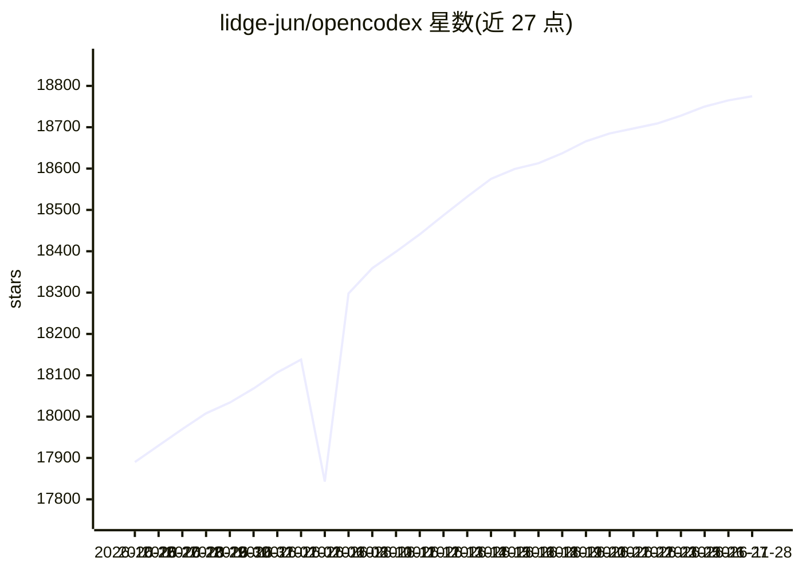

# lidge-jun/opencodex

⭐ 18,775 · TypeScript · MIT · 推送 2026-11-27 · [GitHub](https://github.com/lidge-jun/opencodex) · [官网](https://opencodex.me/) · 个人维护

**本地代理网关：让任意模型接入 Codex、Claude Code 等编码工具**

opencodex 是运行于本地的代理网关，接收 Responses、Chat Completions 与 Anthropic Messages 三种 API 并转换为各提供商的协议，携带流式、工具调用、推理与图片。面向使用 AI 编码工具的开发者：内置 40+ 提供商，支持 provider/model 路由语法、多提供商故障转移/加权的 Combo、OAuth 免 API key、Web 搜索与视觉 sidecar，以及带实时请求日志的 Web 控制台。通过 npm 安装 CLI，亦提供 macOS/Windows/Linux 桌面包；`ocx stop` 可恢复原始配置。

## 筛选速览

| 维度 | 判定 | 备注 |
|---|---|---|
| AI 角色 | `ai-ecosystem` | LLM/agent 周边工具 |
| 许可风险 | `permissive` | MIT |
| 部署形态 | `desktop` | 安装包/桌面程序 |
| 模型依赖 | local-ok | 支持本地模型 |
| 硬件要求 | — | 无带数字的原话,不猜 |
| 安装摩擦 | `low` | 无编译、无系统依赖或容器化 |
| 成熟度 | — | 结构信号不足 |

## 动量与使用信号

- 维护:`active` — 距上次 push 0.8 天,年发版 100,224 位贡献者
- 涨星:近 1 天 **+59**(自 20261016 起算)
- 安装:npm 包 `@bitkyc08/opencodex` 月下载 97,261
- 平台:WINDOWS / MACOS / LINUX · 协议:OPENAI-API / MCP / OLLAMA

## 能力要点

- 40+ 内置提供商，接受 Responses/Chat Completions/Anthropic Messages API 并做协议转换
- provider/model 路由语法与跨提供商故障转移/加权轮询 Combo
- xAI、Anthropic、Kimi 的 OAuth 登录；Web 搜索与视觉 sidecar
- Web 控制台含实时请求日志与缓存 token 统计；ocx stop 无残留退出

## 适用场景

- 在 Codex CLI 中切换使用 Claude、Gemini、DeepSeek 等非 OpenAI 模型
- 通过本地 OpenAI 兼容端点接入 Ollama 等本地运行时
- 为多个 AI 编码工具统一管理提供商账号与密钥

## 场景标签

`模型网关` · 领域:Agent 开发

## 证据(README 行号)

> L50: opencodex is a lightweight local gateway between your coding tools and your model providers. It
> L63: ocx start                         # proxy + dashboard on localhost:10100

## 星数曲线

2026-10-26 17,890 → 2026-11-28 18,775（+885）

---
*卡片 v1 · prompt 1.4 · 生成 2026-11-26 · 置信度 high · 依据 README sha `a3286792b9f5` · [字段定义](../../DATASET.md)*
