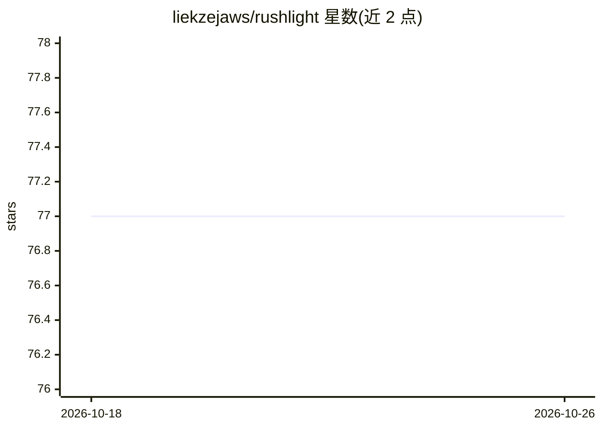

# liekzejaws/rushlight

⭐ 77 · Java · NOASSERTION · 推送 2026-06-24 · [GitHub](https://github.com/liekzejaws/rushlight) · 个人维护

**离线生存手机应用：本地 LLM+地图+P2P 共享，断网可用**

OsmAnd 的 Android fork，面向记者、活动人士与人道工作者等高威胁/断网环境用户。功能包括：基于 llama.cpp 的端侧 LLM 与 RAG（可检索离线维基百科、26 份野外指南与 FieldNotes）、BLE+WiFi Direct 的加密 P2P 共享、ECDSA 签名的共享地图标注 FieldNotes、摩尔斯码通信、威胁模式（紧急 PIN、隐身模式）。需自行编译 APK 并放入 GGUF 模型，AI 功能要求 Android 11+。个人项目，处于活跃开发中。

## 筛选速览

| 维度 | 判定 | 备注 |
|---|---|---|
| AI 角色 | `ai-enhanced` | 去掉 AI 部分产品仍成立 |
| 许可风险 | `none` | NOASSERTION |
| 部署形态 | `None` |  |
| 模型依赖 | local-ok | 支持本地模型 |
| 硬件要求 | — | 无带数字的原话,不猜 |
| 安装摩擦 | `medium` | 含编译或系统依赖之一 |
| 成熟度 | `idea` | |

## 能力要点

- llama.cpp 端侧推理 + RAG（离线维基百科/野外指南/FieldNotes）
- ECDSA P-256 签名的去中心化地图标注，BLE/WiFi Direct 自动同步
- 零遥测、无账号、本地加密存储，含紧急擦除与隐身模式
- 摩尔斯码闪光灯/音频收发，AI 纠错

## 适用场景

- 断网或受监控环境下离线导航与获取急救/生存知识
- 与附近同伴共享加密的地图标注情报
- 无数据连接时用本地 AI 助手查询周边信息

## 场景标签

`AI 助手` `RAG` `文档问答` · 领域:对话与助手

## 证据(README 行号)

> L5: **Offline field intelligence for Android.** AI assistant, encrypted P2P comms, shared map annotations, offline Wikip
> L40: |🤖 **Offline AI**|On-device LLM (llama.cpp) with RAG pipeline — answers questions from offline Wikipedia, 26 field 
> L124: - **llama.cpp** — on-device LLM inference via JNI. Supports any GGUF model.

## 星数曲线

2026-10-18 77 → 2026-10-26 77（+0）

---
*卡片 v1 · prompt 1.4 · 生成 2026-10-24 · 置信度 high · 依据 README sha `59e07b39d244` · [字段定义](../../DATASET.md)*
